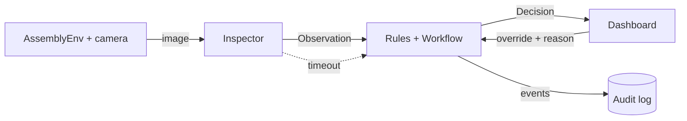

# HoloGuide Roadmap

*Offline AI assembly-inspection assistant for a virtual manufacturing workflow.*
*Plan covers Tuesday Oct 27 (Day 2) to Wednesday Nov 11 (Day 17). Nov 12 is an emergency buffer only.*

## Contents

1. The project in plain language
2. How it works
3. Tech stack
4. Status snapshot
5. Complete remaining task list
6. Team roles
7. Day-by-day schedule
8. Interfaces and contracts
9. Evaluation plan
10. Demo script
11. Risks and fallbacks
12. Git workflow
13. Submission checklist

---

## 1. The project in plain language

**Five-sentence explanation**

1. HoloGuide is a helper that watches a virtual assembly and checks that each of four build steps is done correctly.
2. A simulated overhead camera takes a picture, and a local AI model (Gemma 3 4B) reports which parts it can see.
3. A fixed set of rules then decides whether the build may move to the next step; the AI never makes that decision.
4. If a part is missing, wrong or added out of order, HoloGuide blocks the step and explains the fix in plain words.
5. Everything runs on one laptop with no internet, and a person can read the reasoning and override it by typing a reason.

**Problem it solves.** Assembly mistakes cost factories time and money. Fully scripted systems break when something unexpected happens, and cloud AI is hard to trust on a shop floor because of patchy Wi-Fi, privacy rules and delays. HoloGuide shows a middle path: flexible AI for seeing, predictable rules for deciding.

**Who it helps.**
- Assembly operators, who get an immediate, clear correction.
- Quality leads, who get a record of every check and override.
- Plant engineers, who can inspect and override the system's decisions.

**Honest limits.** This is a simulation-only hackathon prototype. It is not a certified safety system, and results in simulation are not proof of physical-world performance.

---

## 2. How it works

### Architecture

```text
 PyBullet simulation (Partner 1)
 +-------------------------------+
 | AssemblyEnv: parts, scenarios |
 | fixed overhead camera         |
 +---------------+---------------+
                 | rendered image only (never the true answer)
                 v
 AI inspection (Partner 2)
 +-------------------------------+
 | Inspector                     |
 |  - GemmaInspector (Ollama)    |
 |  - OpenCV fallback / Hybrid   |
 |  - timeout + retry wrapper    |
 +---------------+---------------+
                 | Observation (validated by Pydantic)
                 v
 Deterministic control (Partner 3)
 +-------------------------------+
 | Order guard -> Rules engine   |
 | Workflow state machine        |
 | Override (typed reason)       |
 +-------+---------------+-------+
         | Decision      | every event
         v               v
 Dashboard (Partner 4)   Audit log (JSONL)
 image, progress, status, correction message,
 who decided, confidence, override, offline badge
```



### Data flow

1. The operator (or a scripted scenario) adds a part. The **order guard** checks the action first and can block it before any AI is called.
2. `AssemblyEnv.render_to_file()` produces an RGB image. Only the image goes to the inspector. Ground-truth labels are used only by evaluation code.
3. The **Inspector** returns an `Observation`: parts detected, missing, wrong, a confidence, and a one-sentence rationale. Bad or late output becomes a safe low-confidence Observation or a timeout result.
4. The **rules engine** compares the Observation with what the current step requires and creates a `Decision`.
5. The **workflow** changes state only because of a Decision (or an operator override).
6. The **dashboard** shows the result, and the **audit log** records the Observation, the Decision, who decided and any override reason.

### Glossary

| Term | Meaning |
|---|---|
| Observation | What the AI says it sees in one image. It is evidence, not a decision. |
| Decision | What the fixed rules decided: pass, block, needs review or hold. Only the control layer creates one. |
| Override | An operator's choice to approve or reject a result, with a typed reason. Always logged. |
| Hold | Safe stop. Used when the AI times out or fails. The workflow does nothing until the issue is cleared. |
| Needs Review | The AI was not confident enough (below the threshold in `assembly.yaml`). A person must look. |

---

## 3. Tech stack

Everything runs locally on a laptop with a 6 GB GPU. No cloud APIs.

| Area | Tool | Role in HoloGuide |
|---|---|---|
| Language | Python 3.10 or 3.11 | All application code |
| Simulation | PyBullet + NumPy | Virtual assembly, fixed overhead camera, rendered RGB images |
| AI model | Gemma 3 4B (`gemma3:4b`, 4-bit) | Reads rendered images and reports an Observation |
| Model runtime | Ollama (version 0.6 or later) + `ollama` Python library | Runs Gemma locally; schema-constrained JSON output |
| Classic vision | OpenCV (`opencv-python`) + Pillow | Colour masks, contour checks, fallback and Hybrid inspector, image handling |
| Data contracts | Pydantic v2 | Validates Observation, Decision and the config |
| Configuration | PyYAML (`config/assembly.yaml`) | Parts, steps, camera, thresholds, timeout |
| Workflow | Plain Python state machine | Deterministic workflow, order guard, rules (optional: `py_trees` for the writeup diagram) |
| Audit log | JSONL file (`outputs/audit.jsonl`) | Append-only record of every inspection, decision and override |
| Dashboard | Streamlit | Operator interface, override panel, audit viewer, Demo Mode |
| Testing | pytest | Unit, integration and invariant tests |
| Evaluation | Python scripts (optional `pandas`) | Metrics, results CSVs, writeup tables |
| Version control | Git + GitHub | `main`, `dev` and feature branches, PR reviews |
| Editor / notebook | VS Code, Jupyter, Kaggle notebook | Development and the public notebook |
| Diagrams and video | Mermaid, Draw.io or Excalidraw, OBS Studio | Architecture diagram and the 3-minute demo video |

**Installed outside pip:** Ollama (from ollama.com), then `ollama pull gemma3:4b`.

**Current `requirements.txt`:**

```text
pybullet>=3.2.5
numpy>=1.26
ollama>=0.4
pillow>=10.0
opencv-python>=4.9
pydantic>=2.5
pyyaml>=6.0
streamlit>=1.35
pytest>=8.0
```

Optional, only if used: `py_trees>=2.2`, `pandas>=2.0`.

**Deliberately not used:** `torch`, `transformers`, `accelerate`, `bitsandbytes`, ROS 2, Docker, fine-tuning, voice, cloud APIs, custom web frontends.

---

## 4. Status snapshot (as of Mon Oct 26)

**Day 1 finished**
- [x] GitHub repo created with folders
- [x] `requirements.txt` for Ollama, PyBullet, Pydantic, PyYAML, OpenCV, Streamlit, pytest
- [x] `config/assembly.yaml` and `config.py` loader
- [x] `vision/schemas.py` (Observation, Decision)
- [x] PyBullet render script
- [x] Ollama smoke test for Gemma 3 4B
- [x] Passing tests

**Remaining: 73 tasks, listed in full in Section 5**
- [ ] Freeze contracts (Oct 27)
- [ ] Reusable `AssemblyEnv`, decoy part, scenarios, dataset (Oct 27 - Nov 3)
- [ ] `GemmaInspector`, retry, timeout, OpenCV fallback, hybrid (Oct 27 - Nov 6)
- [ ] Workflow, rules, order guard, hold, override, audit log (Oct 27 - Nov 4)
- [ ] End-to-end CLI loop (Nov 1)
- [ ] Dashboard v1 (Nov 3) and v2 (Nov 4 - Nov 6)
- [ ] Evaluation runs and tables (Oct 28 - Nov 7)
- [ ] Demo Mode, README, notebook, writeup, video (Nov 6 - Nov 10)
- [ ] Fresh-clone test and submission (Nov 10 - Nov 11)

---

## 5. Complete remaining task list

Priority: **Must** = needed for a complete demo. **Should** = improves quality; cut if behind. **Nice** = only if ahead. Every task is sized to finish within one working day. Within each table, tasks are sorted by planned date.

### Simulation (Partner 1)

| ID | Feature | Owner | Priority | Planned date |
|---|---|---|---|---|
| SIM-01 | AssemblyEnv skeleton: reset(), render(), close(); camera settings read from config | P1 | Must | Oct 27 |
| SIM-02 | place_part() / remove_part() with stacked geometry; gasket rim stays visible under the cover | P1 | Must | Oct 28 |
| SIM-03 | Green decoy part (wrong_cover) for the wrong-part mistake | P1 | Must | Oct 28 |
| SIM-06 | Dataset generator: rendered images plus a separate labels file the inspector never sees | P1 | Must | Oct 29 |
| SIM-04 | Scenario library: correct, missing_gasket, wrong_cover, wrong_order | P1 | Must | Oct 30 |
| SIM-07 | Scenario runner: plays scripted operator actions into the env step by step | P1 | Must | Oct 31 |
| SIM-09 | Scene polish: camera angle, colours and lighting so parts are easy to tell apart | P1 | Should | Nov 1 |
| SIM-05 | Render randomisation: small lighting, camera and part-offset changes with fixed seeds (dataset v2) | P1 | Should | Nov 2 |
| SIM-10 | Fast render and deterministic seeds so every run is repeatable | P1 | Should | Nov 3 |
| SIM-08 | Extra fault: misaligned or dropped part | P1 | Nice | Nov 6 |
| SIM-11 | Nicer visuals (table texture, labels) for the video | P1 | Nice | Nov 7 |

### Vision and AI inspection (Partner 2)

| ID | Feature | Owner | Priority | Planned date |
|---|---|---|---|---|
| VIS-01 | Prompt templates per step that demand strict JSON | P2 | Must | Oct 27 |
| VIS-02 | GemmaInspector: Ollama call with schema-constrained output, validated into Observation | P2 | Must | Oct 28 |
| VIS-03 | Retry once, then return a safe low-confidence Observation on parse failure | P2 | Must | Oct 29 |
| VIS-05 | Model warm-up (keep_alive) and a VRAM / first-call latency check script | P2 | Should | Oct 29 |
| VIS-06 | Run Gemma on dataset v1 and write an error analysis (feeds the go/no-go) | P2 | Must | Oct 30 |
| VIS-04 | AI timeout wrapper: a slow call returns a timeout result instead of freezing | P2 | Must | Oct 31 |
| VIS-07a | OpenCV colour masks for each part | P2 | Must | Nov 1 |
| VIS-07b | OpenCV per-step presence logic and wrong-colour (decoy) check | P2 | Must | Nov 2 |
| VIS-11 | Turn OpenCV pixel counts into a confidence score | P2 | Should | Nov 2 |
| VIS-09 | HybridInspector: OpenCV decides presence, Gemma explains and handles unclear cases | P2 | Must | Nov 3 |
| VIS-08 | Contour and shape checks (bolts versus other round things, cover versus decoy) | P2 | Should | Nov 4 |
| VIS-12 | Latency benchmark script for every inspector | P2 | Should | Nov 5 |
| VIS-10 | Prompt tuning and image crops based on failures from the first full evaluation | P2 | Should | Nov 6 |

### Control: workflow, rules, override, audit (Partner 3)

| ID | Feature | Owner | Priority | Planned date |
|---|---|---|---|---|
| CTL-01 | Workflow state machine: states and legal transitions only | P3 | Must | Oct 27 |
| SCH-01 | Freeze schemas.py (Observation, Decision) and the interface contracts in this file | P3 | Must | Oct 27 |
| CTL-02 | Rules engine: evaluate(observation, step) returns a Decision | P3 | Must | Oct 28 |
| CTL-08 | Audit log: append-only JSONL, one line per event | P3 | Must | Oct 29 |
| CTL-03 | Correction message templates (missing, wrong part, order, unsure) | P3 | Must | Oct 30 |
| CTL-04 | Confidence threshold sends unsure results to Needs Review | P3 | Must | Oct 30 |
| CTL-05 | Order guard: rejects an out-of-order action before any AI is called | P3 | Must | Oct 31 |
| CTL-11a | Unit tests for rules, order guard and audit log | P3 | Must | Oct 31 |
| CTL-10 | cli.py: the end-to-end loop (act, inspect, decide, log, print) | P3 | Must | Nov 1 |
| CTL-07 | Operator override: approve or reject, typed reason required, logged | P3 | Must | Nov 2 |
| CTL-06 | Hold state on timeout or failure, plus a safe way out of Hold | P3 | Must | Nov 3 |
| CTL-09 | Retry limit: after N failed checks, escalate to Needs Review | P3 | Should | Nov 4 |
| CTL-11b | Integration tests for the full loop using mock objects | P3 | Must | Nov 5 |
| CTL-12 | py_trees view of the tree for the writeup diagram | P3 | Nice | Nov 6 |
| CTL-14 | Clean-up: type hints, docstrings, remove dead code in the control module | P3 | Should | Nov 6 |
| CTL-13 | Export audit log to CSV | P3 | Nice | Nov 7 |

### Dashboard (Partner 4, plus one component from Partner 1)

| ID | Feature | Owner | Priority | Planned date |
|---|---|---|---|---|
| DSH-01 | Streamlit skeleton that runs on mock objects (no real backend needed) | P4 | Must | Oct 29 |
| DSH-02 | Camera image panel and step progress bar | P4 | Must | Oct 30 |
| DSH-03 | Status banner and correction message | P4 | Must | Oct 31 |
| DSH-04 | Decision details: who decided (AI or rule), confidence, rationale | P4 | Must | Oct 31 |
| DSH-08 | Scenario launcher panel: buttons that inject a mistake (thin wrapper over the scenario runner) | P1 | Must | Nov 2 |
| DSH-12 | Connect dashboard to the real workflow, env and inspector (v1) | P4 | Must | Nov 3 |
| DSH-05 | Operator override panel with typed reason | P4 | Must | Nov 4 |
| DSH-07 | Offline indicator: shows the model runs at localhost and no external calls are made | P4 | Must | Nov 4 |
| DSH-06 | Audit log viewer with filter | P4 | Must | Nov 5 |
| DSH-09 | 'Inspecting...' spinner and latency display | P4 | Should | Nov 5 |
| DSH-10 | One-click Demo Mode that plays the whole scripted demo | P4 | Must | Nov 6 |
| DSH-11 | Visual polish and theme | P4 | Nice | Nov 7 |

### Evaluation and testing

| ID | Feature | Owner | Priority | Planned date |
|---|---|---|---|---|
| TST-01 | pytest setup, shared fixtures, how to run tests in the README | P4 | Must | Oct 27 |
| EVL-01a | Metric functions: accuracy per mistake type, false-block rate, latency stats | P4 | Must | Oct 28 |
| EVL-01b | run_eval.py: runs any inspector over the dataset and writes a results CSV | P4 | Must | Oct 29 |
| EVL-04 | Invariant test: no step ever advances without a pass or a logged override | P3 | Must | Nov 4 |
| EVL-03 | Recovery trials: 20 runs per scenario through the full loop | P1 | Must | Nov 5 |
| EVL-02 | Report generator: results CSV becomes the writeup tables | P4 | Must | Nov 6 |
| EVL-05 | Final evaluation run on the full dataset and all scenarios (numbers for the writeup) | P4 | Must | Nov 7 |

### Documentation and demo

| ID | Feature | Owner | Priority | Planned date |
|---|---|---|---|---|
| GIT-01 | Repo hygiene: branch protection, PR template, issue labels | P4 | Must | Oct 27 |
| DOC-02 | Architecture diagram as an image for the writeup | P1 | Must | Nov 4 |
| DOC-04a | Public notebook skeleton: setup, run one scenario, show results | P2 | Must | Nov 6 |
| DOC-05a | Video setup: screen recorder, audio, one test clip | P1 | Must | Nov 6 |
| DOC-03a | Writeup draft (problem, architecture, trade-offs, results) | P4 | Must | Nov 7 |
| DOC-03c | Writeup section: simulation and evaluation setup | P1 | Must | Nov 7 |
| DOC-03d | Writeup section: AI inspection and why Gemma 3 4B | P2 | Must | Nov 7 |
| DOC-03e | Writeup section: control logic, safety and override | P3 | Must | Nov 7 |
| DOC-01 | README: install, run, offline note, team roles | P1 | Must | Nov 8 |
| DOC-03b | Writeup final edit with all partner sections | P4 | Must | Nov 9 |
| DOC-04b | Finish notebook and confirm it runs top to bottom | P2 | Must | Nov 9 |
| DOC-05b | Record video take 1 from the demo script | P1 | Must | Nov 9 |
| DOC-05c | Final video, backup recording, upload | P1 | Must | Nov 10 |
| DOC-06 | Fresh-clone test on a second laptop and submission checklist | P4 | Must | Nov 10 |

### Task count per partner

| Partner | Must | Should | Nice | Total tasks |
|---|---:|---:|---:|---:|
| P1 | 14 | 3 | 2 | 19 |
| P2 | 11 | 5 | 0 | 16 |
| P3 | 14 | 2 | 2 | 18 |
| P4 | 18 | 1 | 1 | 20 |

Workload is balanced by task count and difficulty rather than hours. Partners with fewer tasks on a given day (see Section 7) cover reviews and unblocking.

### Cut list (drop in this order)

| Order | Items to drop | Drop when |
|---|---|---|
| 1 | SIM-11, DSH-11, CTL-12, CTL-13, SIM-08 (all Nice) | Any task slips by one day |
| 2 | VIS-08, VIS-11, VIS-12, VIS-05 | Dashboard v1 is not working at the end of Nov 3 |
| 3 | SIM-10, SIM-09, DSH-09, CTL-14 | Behind at the end of Nov 6 |
| 4 | CTL-09, VIS-10 | Behind at the end of Nov 7 |
| Never cut | Order guard, rules engine, hold, override, audit log, offline indicator, Demo Mode, writeup, video | - |

---

## 6. Team roles

| Partner | Owns | Does NOT own |
|---|---|---|
| **Partner 1: Simulation and scenarios** | `src/simulation/`, dataset generator, scenario runner and panel, recovery trials, architecture diagram, README, video | Rules, prompts, dashboard layout |
| **Partner 2: AI inspection** | `src/vision/` (prompts, GemmaInspector, OpenCV, Hybrid, timeout), Gemma error analysis, notebook | Workflow rules, scene geometry |
| **Partner 3: Control** | `src/control/` (workflow, rules, order guard, hold, override, audit log), `schemas.py`, CLI, invariant test | Image processing, Streamlit layout |
| **Partner 4: Dashboard, testing, docs** | `src/dashboard/`, `src/eval/`, pytest setup, Git hygiene, writeup lead, fresh-clone test, Demo Mode | Scene or inspector internals |

**Code review pairs** (one approval required before merging):

| Author | Reviewer | Why this pairing |
|---|---|---|
| Partner 1 | Partner 2 | Partner 2 consumes Partner 1's images |
| Partner 2 | Partner 1 | Partner 1 sees whether the inspector matches the scene |
| Partner 3 | Partner 4 | Partner 4's dashboard depends on Partner 3's workflow |
| Partner 4 | Partner 3 | Partner 3 checks the UI never bypasses the rules |
| Changes to `schemas.py` or contracts | All four | A contract change breaks everyone |

**Working agreements**
- 15-minute standup each day (only for partners working that day): done yesterday, doing today, blocked.
- If blocked for more than 2 hours, say so in the team chat.
- Everyone works against the mocks in Section 8 until the real part is merged.
- A partner with a "Review PRs only" day still reviews open PRs within the day.
- The AI never advances a step. Only `Workflow` does.

---

## 7. Day-by-day schedule (Oct 27 to Nov 11)

Key milestones: **Oct 30** go/no-go, **Nov 1** CLI loop, **Nov 3** Dashboard v1, **Nov 8** feature freeze and rehearsal 1, **Nov 10** offline dress rehearsal and fresh-clone test, **Nov 11** submission. No new features after Nov 8.

### Go/no-go rule (Oct 30)

Measure on dataset v1. These thresholds are the team's own targets, not industry standards.

| Option | When | What happens |
|---|---|---|
| A: Gemma primary | Accuracy on missing and wrong-part at least 85%, false-block rate at most 8%, median latency at most 10 s | Gemma is the inspector; OpenCV stays a backup |
| B: Hybrid | Accuracy 60-85% or latency 10-20 s | OpenCV decides which parts are present; Gemma explains and handles unclear cases |
| C: OpenCV primary | Accuracy below 60%, latency above 20 s or VRAM errors | OpenCV produces the Observation; Gemma only writes the explanation, and is dropped if it is still unreliable |

For options B and C, Partner 2 swaps Oct 31 and Nov 1 (do `VIS-07a` first, then `VIS-04`) so the Nov 1 loop still works.

### Day 2 - Tue Oct 27: Freeze the contracts; each partner has a working skeleton.

| Partner | Tasks |
|---|---|
| P1 | `SIM-01` AssemblyEnv skeleton: reset(), render(), close(); camera settings read from config |
| P2 | `VIS-01` Prompt templates per step that demand strict JSON |
| P3 | `SCH-01` Freeze schemas.py (Observation, Decision) and the interface contracts in this file<br>`CTL-01` Workflow state machine: states and legal transitions only |
| P4 | `GIT-01` Repo hygiene: branch protection, PR template, issue labels<br>`TST-01` pytest setup, shared fixtures, how to run tests in the README |

**Done when:** Contracts merged to `dev`; `pytest` passes on every laptop; `AssemblyEnv.render()` returns an image; workflow transitions are tested.

### Day 3 - Wed Oct 28: Real pieces replace skeletons.

| Partner | Tasks |
|---|---|
| P1 | `SIM-02` place_part() / remove_part() with stacked geometry; gasket rim stays visible under the cover<br>`SIM-03` Green decoy part (wrong_cover) for the wrong-part mistake |
| P2 | `VIS-02` GemmaInspector: Ollama call with schema-constrained output, validated into Observation |
| P3 | `CTL-02` Rules engine: evaluate(observation, step) returns a Decision |
| P4 | `EVL-01a` Metric functions: accuracy per mistake type, false-block rate, latency stats |

**Done when:** Env places and removes parts and the gasket rim is visible under the cover; Gemma returns a valid `Observation` for one image; `evaluate()` returns pass or block for mock observations; metric functions pass unit tests.

### Day 4 - Thu Oct 29: Dataset v1 and the audit log.

| Partner | Tasks |
|---|---|
| P1 | `SIM-06` Dataset generator: rendered images plus a separate labels file the inspector never sees |
| P2 | `VIS-03` Retry once, then return a safe low-confidence Observation on parse failure<br>`VIS-05` Model warm-up (keep_alive) and a VRAM / first-call latency check script |
| P3 | `CTL-08` Audit log: append-only JSONL, one line per event |
| P4 | `EVL-01b` run_eval.py: runs any inspector over the dataset and writes a results CSV<br>`DSH-01` Streamlit skeleton that runs on mock objects (no real backend needed) |

**Done when:** Dataset v1 (at least 160 images plus a labels file) exists; `run_eval.py` runs end to end on `MockInspector`; audit log writes JSONL; the dashboard skeleton opens with mocks.

### Day 5 - Fri Oct 30: GO/NO-GO CHECKPOINT: Gemma versus the OpenCV hybrid.

| Partner | Tasks |
|---|---|
| P1 | `SIM-04` Scenario library: correct, missing_gasket, wrong_cover, wrong_order |
| P2 | `VIS-06` Run Gemma on dataset v1 and write an error analysis (feeds the go/no-go) |
| P3 | `CTL-03` Correction message templates (missing, wrong part, order, unsure)<br>`CTL-04` Confidence threshold sends unsure results to Needs Review |
| P4 | `DSH-02` Camera image panel and step progress bar |

**Done when:** Gemma's results on dataset v1 are written in `docs/decisions.md` with the chosen option (A, B or C), and every partner has read it. Whole team: go/no-go meeting.

### Day 6 - Sat Oct 31: Scenarios, order guard and timeout.

| Partner | Tasks |
|---|---|
| P1 | `SIM-07` Scenario runner: plays scripted operator actions into the env step by step |
| P2 | `VIS-04` AI timeout wrapper: a slow call returns a timeout result instead of freezing |
| P3 | `CTL-05` Order guard: rejects an out-of-order action before any AI is called<br>`CTL-11a` Unit tests for rules, order guard and audit log |
| P4 | `DSH-03` Status banner and correction message<br>`DSH-04` Decision details: who decided (AI or rule), confidence, rationale |

**Done when:** The scenario runner plays all four scenarios; the order guard blocks cover-before-gasket without calling the AI; a deliberately slow fake inspector produces a timeout result.

### Day 7 - Sun Nov 1: MILESTONE: end-to-end CLI loop.

| Partner | Tasks |
|---|---|
| P1 | `SIM-09` Scene polish: camera angle, colours and lighting so parts are easy to tell apart |
| P2 | `VIS-07a` OpenCV colour masks for each part |
| P3 | `CTL-10` cli.py: the end-to-end loop (act, inspect, decide, log, print) |
| P4 | Review PRs only |

**Done when:** `python -m src.control.cli --scenario missing_gasket` shows: step blocked, message printed, gasket added, re-inspected, passes, workflow continues to Complete; every event is in the audit log. It works with the chosen inspector. Whole team: CLI-loop integration session.

### Day 8 - Mon Nov 2: Override, OpenCV detector and scenario panel.

| Partner | Tasks |
|---|---|
| P1 | `SIM-05` Render randomisation: small lighting, camera and part-offset changes with fixed seeds (dataset v2)<br>`DSH-08` Scenario launcher panel: buttons that inject a mistake (thin wrapper over the scenario runner) |
| P2 | `VIS-07b` OpenCV per-step presence logic and wrong-colour (decoy) check<br>`VIS-11` Turn OpenCV pixel counts into a confidence score |
| P3 | `CTL-07` Operator override: approve or reject, typed reason required, logged |
| P4 | Review PRs only |

**Done when:** Override refuses an empty reason and logs the reason; OpenCV masks detect parts on dataset v1; the scenario panel runs from a script.

### Day 9 - Tue Nov 3: MILESTONE: Dashboard v1.

| Partner | Tasks |
|---|---|
| P1 | `SIM-10` Fast render and deterministic seeds so every run is repeatable |
| P2 | `VIS-09` HybridInspector: OpenCV decides presence, Gemma explains and handles unclear cases |
| P3 | `CTL-06` Hold state on timeout or failure, plus a safe way out of Hold |
| P4 | `DSH-12` Connect dashboard to the real workflow, env and inspector (v1) |

**Done when:** Streamlit shows the live image, step progress, status, correction message and decision details from the real workflow; Hold works; `HybridInspector` can be called. Whole team: dashboard v1 session.

### Day 10 - Wed Nov 4: Dashboard v2 and safety invariant.

| Partner | Tasks |
|---|---|
| P1 | `DOC-02` Architecture diagram as an image for the writeup |
| P2 | `VIS-08` Contour and shape checks (bolts versus other round things, cover versus decoy) |
| P3 | `CTL-09` Retry limit: after N failed checks, escalate to Needs Review<br>`EVL-04` Invariant test: no step ever advances without a pass or a logged override |
| P4 | `DSH-05` Operator override panel with typed reason<br>`DSH-07` Offline indicator: shows the model runs at localhost and no external calls are made |

**Done when:** Override panel and offline indicator work; the invariant test (500 random action sequences, no step advances without a pass or logged override) passes; architecture diagram draft exists.

### Day 11 - Thu Nov 5: Bug bash and evaluation run 1.

| Partner | Tasks |
|---|---|
| P1 | `EVL-03` Recovery trials: 20 runs per scenario through the full loop |
| P2 | `VIS-12` Latency benchmark script for every inspector |
| P3 | `CTL-11b` Integration tests for the full loop using mock objects |
| P4 | `DSH-06` Audit log viewer with filter<br>`DSH-09` 'Inspecting...' spinner and latency display |

**Done when:** `eval_run1.csv` exists; bugs are triaged in GitHub Issues (P0, P1, P2); recovery trials run 1 recorded. Whole team: bug bash and evaluation run 1.

### Day 12 - Fri Nov 6: Fix and tune from run 1; Demo Mode; start the video and notebook.

| Partner | Tasks |
|---|---|
| P1 | `DOC-05a` Video setup: screen recorder, audio, one test clip<br>`SIM-08` Extra fault: misaligned or dropped part |
| P2 | `VIS-10` Prompt tuning and image crops based on failures from the first full evaluation<br>`DOC-04a` Public notebook skeleton: setup, run one scenario, show results |
| P3 | `CTL-14` Clean-up: type hints, docstrings, remove dead code in the control module<br>`CTL-12` py_trees view of the tree for the writeup diagram |
| P4 | `DSH-10` One-click Demo Mode that plays the whole scripted demo<br>`EVL-02` Report generator: results CSV becomes the writeup tables |

**Done when:** Top 5 failures fixed or consciously accepted; `EVL-02` produces the writeup tables; one-click Demo Mode plays the whole scripted demo without typing; notebook skeleton runs; a test video clip is recorded.

### Day 13 - Sat Nov 7: Final numbers and writeup draft.

| Partner | Tasks |
|---|---|
| P1 | `DOC-03c` Writeup section: simulation and evaluation setup<br>`SIM-11` Nicer visuals (table texture, labels) for the video |
| P2 | `DOC-03d` Writeup section: AI inspection and why Gemma 3 4B |
| P3 | `DOC-03e` Writeup section: control logic, safety and override<br>`CTL-13` Export audit log to CSV |
| P4 | `EVL-05` Final evaluation run on the full dataset and all scenarios (numbers for the writeup)<br>`DOC-03a` Writeup draft (problem, architecture, trade-offs, results)<br>`DSH-11` Visual polish and theme |

**Done when:** Final evaluation run complete (`eval_final.csv`); writeup draft contains all sections and real numbers; every partner section is in.

### Day 14 - Sun Nov 8: FEATURE FREEZE and offline rehearsal 1.

| Partner | Tasks |
|---|---|
| P1 | `DOC-01` README: install, run, offline note, team roles |
| P2 | Review PRs only |
| P3 | Review PRs only |
| P4 | Review PRs only |

**Done when:** Tag `v0.9-freeze` created; no open P0 bugs; README complete; rehearsal finishes in 3:00 or less with Wi-Fi off. After today: bug fixes only. Whole team: freeze meeting and rehearsal 1.

### Day 15 - Mon Nov 9: Bug fixes only; video take 1; notebook and writeup finished.

| Partner | Tasks |
|---|---|
| P1 | `DOC-05b` Record video take 1 from the demo script |
| P2 | `DOC-04b` Finish notebook and confirm it runs top to bottom |
| P3 | Bug-fix reserve (fixes only) |
| P4 | `DOC-03b` Writeup final edit with all partner sections |

**Done when:** Notebook runs top to bottom on a clean environment; writeup final draft ready; video take 1 recorded.

### Day 16 - Tue Nov 10: Fresh clone, offline dress rehearsal, final video.

| Partner | Tasks |
|---|---|
| P1 | `DOC-05c` Final video, backup recording, upload |
| P2 | Bug-fix reserve (fixes only) |
| P3 | Bug-fix reserve (fixes only) |
| P4 | `DOC-06` Fresh-clone test on a second laptop and submission checklist |

**Done when:** A fresh clone on a second laptop passes tests and runs the demo with Wi-Fi off; final and backup videos uploaded; `v1.0-rc` tagged. Whole team: dress rehearsal 2 and fresh-clone test.

### Day 17 - Wed Nov 11: SUBMISSION DAY.

| Partner | Tasks |
|---|---|
| P1 | Review PRs only |
| P2 | Review PRs only |
| P3 | Review PRs only |
| P4 | Review PRs only |

**Done when:** Kaggle submission confirmed (screenshot saved); tag `v1.0`; repo public; all links open while logged out. Nov 12 is an emergency buffer only. Whole team: final review and submission.

---

## 8. Interfaces and contracts

Agree on these on Oct 27 (`SCH-01`). Changing a signature later needs all four partners' approval. If `schemas.py` from Day 1 differs from the types below, `schemas.py` is the source of truth; update this section to match it.

### Files

| File | Owner |
|---|---|
| `src/simulation/assembly_env.py`, `scenarios.py` | P1 |
| `src/vision/schemas.py` | P3 (all approve changes) |
| `src/vision/inspector.py` (base class, `MockInspector`) | P2 |
| `src/vision/gemma_inspector.py`, `cv_inspector.py`, `hybrid_inspector.py` | P2 |
| `src/control/rules.py`, `workflow.py`, `audit_log.py`, `cli.py` | P3 |
| `src/dashboard/app.py` | P4 |
| `src/eval/run_eval.py`, `metrics.py` | P4 |

### Signatures

```python
# src/simulation/assembly_env.py  (Partner 1)
class AssemblyEnv:
    def __init__(self, config: AssemblyConfig, seed: int | None = None, randomize: bool = False): ...
    def reset(self) -> None: ...
    def place_part(self, part: str) -> None: ...
    def remove_part(self, part: str) -> None: ...
    def render_to_file(self, path: str) -> str: ...
    def parts_present(self) -> list[str]: ...   # GROUND TRUTH: evaluation and tests only
    def close(self) -> None: ...

# src/simulation/scenarios.py  (Partner 1)
@dataclass
class Action:
    kind: Literal["place", "remove"]
    part: str

@dataclass
class Scenario:
    name: str                      # correct | missing_gasket | wrong_cover | wrong_order
    actions: list[Action]
    expected_first_status: str     # "pass" or "block"

def get_scenario(name: str) -> Scenario: ...

# src/vision/inspector.py  (Partner 2)
class Inspector(ABC):
    @abstractmethod
    def inspect(self, image_path: str, step_id: int) -> Observation: ...
# MockInspector, GemmaInspector, CVInspector, HybridInspector.
# A failure or timeout must NEVER raise into the workflow; it returns a
# low-confidence Observation (confidence 0.0) or a timeout marker.

# src/control/rules.py  (Partner 3)
def evaluate(observation: Observation, step: StepSpec, threshold: float) -> Decision: ...

# src/control/workflow.py  (Partner 3)
class WorkflowState(str, Enum):
    WAITING = "waiting"; INSPECTING = "inspecting"; BLOCKED = "blocked"
    NEEDS_REVIEW = "needs_review"; HOLD = "hold"
    STEP_COMPLETE = "step_complete"; COMPLETE = "complete"

class Workflow:
    def __init__(self, config: AssemblyConfig, inspector: Inspector, audit: "AuditLog"): ...
    def check_action(self, part: str) -> ActionCheck: ...            # order guard, no AI
    def request_inspection(self, image_path: str) -> Decision: ...
    def operator_override(self, approve: bool, reason: str, operator: str) -> Decision: ...
    def clear_hold(self, operator: str, reason: str) -> None: ...
    def status(self) -> dict: ...                                     # for the dashboard

# src/control/audit_log.py  (Partner 3)
class AuditLog:
    def __init__(self, path: str = "outputs/audit.jsonl"): ...
    def record(self, event_type: str, **fields) -> None: ...
    def read_all(self) -> list[dict]: ...
```

Rules that every partner follows:
- `operator_override` raises an error if `reason` is empty.
- The only code that changes `Workflow.current_step` is inside `workflow.py`.
- The order guard is a pre-check. For evaluation, the "wrong order" scenario also places the part physically so the visual path is tested too.
- The decoy part is named `wrong_cover` (green). It is already in `assembly.yaml`.

### Mocks that unblock teammates

| Mock | File | Used by | Behaviour |
|---|---|---|---|
| `MockInspector(config, mode, target)` | `vision/inspector.py` | P3, P4 | Returns correct, missing, wrong or uncertain Observations on demand |
| `SlowInspector(delay_s)` | `vision/inspector.py` | P3 | Sleeps to trigger the timeout and Hold path |
| `MockEnv` | `simulation/mock_env.py` | P2, P3, P4 | `render_to_file` copies a saved PNG from `assets/` per scenario |
| `MockWorkflow` | `control/mock_workflow.py` | P4 | Returns a fixed `status()` dict and canned Decisions for dashboard layout |

---

## 9. Evaluation plan

**Dataset.** Generated by `SIM-06` and `SIM-05`, with labels in a separate file the inspector never sees. Target: at least 80 correct images and at least 40 images for each mistake type (missing part, wrong part, wrong order), spread across the four steps, with lighting and offset variation in v2.

**Metrics**

| Metric | Definition |
|---|---|
| Detection accuracy per mistake type | Share of images where the Decision status matches the expected status (block for a mistake, pass for correct) |
| False-block rate | Share of correct images that the system blocked |
| Recovery success | Share of 20 runs per scenario where the sequence is blocked, fixed, re-inspected, then passes |
| Latency | Median and 95th-percentile seconds per inspection, measured on the demo laptop |
| Safety invariant | Number of steps advanced without a pass or a logged override. Target: exactly 0 |

Targets for the team to aim for (not promises): accuracy at least 90% per mistake type, false-block at most 5%, recovery success at least 90%. Report the real numbers even if lower.

**Writeup table formats**

| Mistake type | Images | Gemma only | OpenCV only | Hybrid |
|---|---:|---:|---:|---:|
| Missing part | | | | |
| Wrong part | | | | |
| Wrong order | | | | |
| Correct (false-block rate) | | | | |

| Scenario | Runs | Recovered | Recovery rate | Median time to resume (s) |
|---|---:|---:|---:|---:|
| missing_gasket | 20 | | | |
| wrong_cover | 20 | | | |
| wrong_order | 20 | | | |

| Inspector | Median latency (s) | 95th percentile (s) | Timeouts |
|---|---:|---:|---:|
| Gemma 3 4B (4-bit) | | | |
| OpenCV | | | |
| Hybrid | | | |

| Safety check | Result |
|---|---|
| Steps advanced without pass or logged override | 0 (500 random action sequences) |
| Overrides without a typed reason | 0 |
| Network calls during demo | 0 (Wi-Fi off) |

---

## 10. Demo script (3:00)

Run it with Wi-Fi off. Demo Mode (`DSH-10`) plays it, but the presenters narrate live.

| Time | What the audience sees | Presenter |
|---|---|---|
| 0:00-0:20 | The problem: assembly errors, and why AI needs rules around it. Offline badge visible. | P4 |
| 0:20-0:50 | Normal run: base plate and gasket placed, each step inspected and passed. | P1 |
| 0:50-1:20 | Mistake: the cover is attached without a gasket. The step is BLOCKED with the message "Gasket missing - insert it before attaching the cover." The panel shows Observation, confidence and "decided by: rule". | P2 |
| 1:20-1:50 | Fix: the gasket is added, the system re-inspects, the step passes, and the workflow continues to bolts and Complete. | P3 |
| 1:50-2:20 | Second mistake: the green wrong cover is blocked. A part tried out of order is rejected by the order guard before the AI is called. | P1 and P2 |
| 2:20-2:40 | Edge case: a low-confidence image goes to Needs Review, then a deliberately slow AI call times out and the system goes to Hold. | P3 |
| 2:40-2:55 | Override: the operator approves with a typed reason; the reason appears in the audit log. | P3 and P4 |
| 2:55-3:00 | Closing numbers from the evaluation table and one sentence: AI sees, rules decide, people oversee. | P4 |

Backup: a recorded version of the same run (`DOC-05c`).

---

## 11. Risks and fallbacks

| # | Risk | Trigger | Mitigation | Owner |
|---|---|---|---|---|
| 1 | Gemma is slow or inaccurate | Oct 30 results fall in option B or C | Switch to the Hybrid or OpenCV-primary design; keep Gemma for explanations only | P2 |
| 2 | VRAM limit (6 GB) | Out-of-memory error or latency above 20 s | Smaller images (512x512), one image per call, `keep_alive`, close other GPU apps, shorter prompt | P2 |
| 3 | Integration delays | CLI loop not working by the end of Nov 1 | Pairing session; use mocks to find the broken seam; stop all Should work until fixed | P3 |
| 4 | Git conflicts | A merge conflict that takes more than 30 minutes | Small PRs, daily merge to `dev`, one owner per file, contracts changed only by agreement | P4 |
| 5 | A teammate becomes unavailable | No update for 24 hours | Cut list levels 1 and 2; the reviewer for that area takes over; reduce scope, not schedule | All |
| 6 | Dashboard overrun | Dashboard v1 not working by the end of Nov 3 | Keep Streamlit minimal (image, status, message, override); drop DSH-09, DSH-11; CLI demo as last resort | P4 |
| 7 | Demo failure | Any crash in rehearsal 1 or 2, or the live model load fails | Warm up the model before recording, scripted Demo Mode, recorded backup video, saved sample images | P1 |
| 8 | Scope creep | Anyone proposes a new feature after Nov 3 | Check the cut list; new ideas go into an "after the hackathon" list; no features after Nov 8 | P3 |

---

## 12. Git workflow

**Branches**
- `main`: always runs. Protected. Only receives merges from `dev` at milestones.
- `dev`: the team's integration branch.
- Feature branches: `feat/<area>-<short-name>` (for example `feat/sim-assembly-env`), `fix/<area>-<short-name>`, `docs/<short-name>`.

**Pull requests**
- Keep each PR under about 300 changed lines and tie it to a task ID in the title (for example `SIM-02: place and remove parts`).
- One approval from the reviewer in Section 6, and `pytest` must pass locally. Note the test result in the PR description.
- Never commit model files, outputs or generated images. `outputs/` stays ignored.
- The author merges after approval. Resolve conflicts on your own branch before merging.

**Merge schedule**
- Feature to `dev`: any time, at least once a day.
- `dev` to `main`: Nov 1 (CLI loop), Nov 3 (Dashboard v1), Nov 8 (freeze, tag `v0.9-freeze`), Nov 10 (tag `v1.0-rc`), Nov 11 (tag `v1.0`).
- After Nov 8: only `fix/` branches, each with a description of the bug and the test that proves it is fixed.

**Commit messages:** `type(scope): short summary`, where type is `feat`, `fix`, `test`, `docs`, `refactor` or `chore`. Example: `feat(control): add order guard for out-of-order actions`.

---

## 13. Submission checklist

- [ ] README: install steps, how to run tests, how to run the dashboard and the CLI, offline note, team roles
- [ ] Public GitHub repo opens while logged out; no secrets or large model files
- [ ] Public Kaggle notebook runs top to bottom on a clean environment
- [ ] Architecture diagram (image) included in the writeup and README
- [ ] Kaggle writeup: problem, architecture, data and control flow, model and topology choices (single-device, local), trade-offs, results tables, limitations
- [ ] Writeup states what happens on a mistake, a timeout and an override
- [ ] 3-minute video showing the full flow, including an error and an edge case
- [ ] Backup video saved in a second location
- [ ] Fresh-clone test passed on a second laptop with Wi-Fi off
- [ ] Final numbers in the writeup match `eval_final.csv`
- [ ] Release tag `v1.0` pushed
- [ ] Submission confirmed on Kaggle (screenshot saved)
- [ ] Nov 12 left untouched as an emergency buffer
