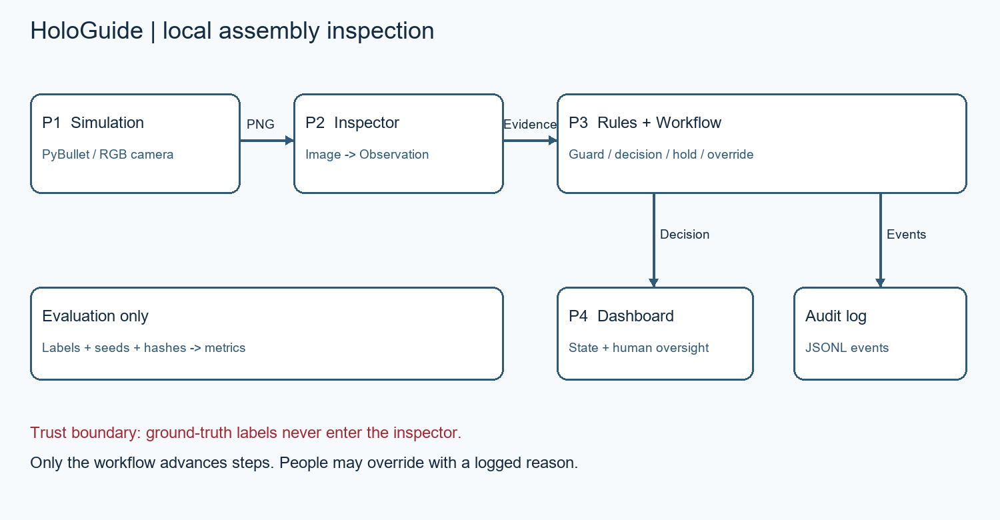

# HoloGuide

HoloGuide is a local, simulation-only assembly inspection prototype. PyBullet renders
four assembly steps; OpenCV/Gemma inspectors return observations; deterministic rules
and Workflow authorize progress; Streamlit displays corrections and audit events.
It detects missing parts, wrong parts and visible out-of-order parts. It does not
establish physical-world performance or infer historical action order from a still image.

## Current integration status (November 12, 2026)

All four contributions ship in this snapshot: simulation/datasets/scenarios (P1),
OpenCV/Gemma/Hybrid inspection (P2), control/workflow/audit and real CLI (P3), and
dashboard/evaluation/reporting (P4). Real dashboard wiring is implemented through
`src.simulation.backend:create_session`; no custom teammate module is required.

See [current validation and remaining acceptance](docs/VALIDATION.md).
[Vision decisions](docs/decisions.md) records teammate-reported November 7 synthetic
results; the generated raw datasets and run artifacts are not included in this ZIP.
Those figures are historical evidence, not measurements from the current validation.
Older dated progress reports are historical; this README and VALIDATION.md describe
the current package. Full hackathon submission readiness still requires the target
laptop/offline rehearsal, final video, finalized submission materials and link checks.

## Install and test on Windows

Use Python 3.11 or 3.12. On this Windows host, both selected a PyBullet source
build, and no compatible wheel was found on the package index. Install Microsoft
C++ Build Tools (MSVC C++ compiler and Windows SDK) for that path, or use a host
with a compatible wheel/toolchain. Python 3.11 alone did not resolve installation.
Run from this folder after preparing that prerequisite:

```powershell
py -3.11 -m venv .venv
.\.venv\Scripts\python.exe -m pip install -r requirements.txt
.\.venv\Scripts\python.exe -m pytest -q
.\.venv\Scripts\python.exe -m pip check
```

For mock-only development, install `pytest pydantic pyyaml streamlit`. This subset
runs the mock dashboard and control code, but cannot run the complete suite, whose
simulation and vision tests need the full requirements. Tests use local fixtures;
passing them does not prove a live Ollama/Gemma service works.

## Dashboard and CLI

```powershell
.\.venv\Scripts\python.exe -m streamlit run src/dashboard/app.py
```

The dashboard starts in Mock mode with deterministic JSON scenes. The scripted mock
demo includes faults, corrections, review, injected timeout, HOLD recovery and an
explicitly logged override. It is not AI performance evidence.

For rendered-image inspection, configure the built-in backend before starting:

```powershell
$env:HOLOGUIDE_BACKEND_FACTORY = 'src.simulation.backend:create_session'
$env:HOLOGUIDE_INSPECTOR_FACTORY = 'src.vision.factories:hybrid'
$env:HOLOGUIDE_MODEL_NAME = 'gemma3:4b'
$env:HOLOGUIDE_MODEL_ENDPOINT = 'http://localhost:11434'
.\.venv\Scripts\python.exe -m streamlit run src/dashboard/app.py
```

Select Real, then Start selected mode / reset session. Load a scenario in a fresh
session and play its steps. Reset between scenarios and before leaving to close
resources. Browser-tab closure does not guarantee immediate resource cleanup.
`src.vision.factories:cv` uses OpenCV without Ollama; `:gemma` uses only Gemma;
`:hybrid` uses OpenCV and asks Gemma when uncertain; `:hybrid_explained` also asks
Gemma for explanatory text on every image. Provision Ollama and the chosen model
before using Gemma. No factory downloads a model or silently substitutes mock data.
Hybrid's reported clean-render benchmarks used no Gemma calls: describe them as
OpenCV-led results, and rehearse the live model path separately.

```powershell
.\.venv\Scripts\python.exe -m src.control.cli --scenario missing_gasket
.\.venv\Scripts\python.exe -m src.control.cli --mode real --scenario wrong_cover --inspector-factory src.vision.factories:cv
```

Workflow guards placement and progression. Removing verified parts invalidates
approval. Overrides require an operator identity and typed reason; audits persist
under ignored `outputs/`. The current scene and last inspected frame are distinct.

## Evaluation and provenance

```powershell
.\.venv\Scripts\python.exe -m src.simulation.dataset --output outputs/dataset-v2 --randomize --seed 2026
.\.venv\Scripts\python.exe -m src.evaluation.runner outputs/dataset-v2/labels.csv --inspector-factory src.vision.factories:hybrid --model gemma3:4b --endpoint http://localhost:11434 --output outputs/evaluation/hybrid-v2.csv
.\.venv\Scripts\python.exe -m src.evaluation.report --result "Hybrid=outputs/evaluation/hybrid-v2.csv" --output outputs/evaluation/comparison.md
.\.venv\Scripts\python.exe -m src.evaluation.recovery --output outputs/recovery/cv-run --inspector-factory src.vision.factories:cv --runs 20 --evidence real-inspector
```

Output paths must be new. The manifest requires `image_path,step_id,mistake_type,
expected_status`; the included generator supplies this contract. Labels stay in
scoring; inspectors receive only an image and StepSpec. All built-in factories
accept StepSpec; no `--step-id-interface` adapter is needed. The evaluation CLI
defaults to JSON mocks, so always specify an image inspector for generated PNGs.

Each run saves case CSV, summary JSON, Markdown tables and provenance with dataset,
image and runtime-source hashes, configuration, packages and model metadata.
`code_revision` and `working_tree_dirty` are null when Git history is unavailable;
`revision_status` makes that explicit. `source_sha256` fingerprints sorted paths
and LF-normalized contents of `src/**/*.py`, `config/*.yaml` and `requirements.txt`,
including dirty source edits and ZIP exports. It is not a fabricated Git commit.
Record actual hardware and model digest separately.

Accuracy is exact expected/actual decision agreement by mistake type; failures stay
in denominators. False-block rate is BLOCK / expected PASS cases. HOLD and review
are separate. Explicit TimeoutError is timeout evidence; low confidence alone is
not. Latency includes inspection, validation and rules, excluding render/write time;
p95 is linearly interpolated. Dashboard latency also includes workflow/audit work.
Compare inspectors on matching manifest hashes and conditions.

## Notebook, offline demo and handoff

`notebooks/hologuide_demo.ipynb` is included with saved outputs. To execute it:

```powershell
.\.venv\Scripts\python.exe -m pip install nbconvert ipykernel
.\.venv\Scripts\python.exe -m jupyter nbconvert --to notebook --execute notebooks/hologuide_demo.ipynb --output-dir outputs/notebook-run
```

The notebook uses Hybrid when local Ollama serves the model, otherwise OpenCV;
it never downloads a model. Install packages and provision models before disconnecting
Wi-Fi. Telemetry is disabled for Streamlit, but network activity is not monitored.
A successful localhost call alone does not prove zero external traffic.



P1 owns simulation, datasets, scenarios, recovery and video; P2 owns inspectors and
model evidence; P3 owns control, authorization and audit; P4 owns dashboard,
evaluation/reporting and final documentation coordination. See the current
[P4 writeup](docs/PERSON4_WRITEUP.md), [simulation guide](docs/PARTNER1_TECHNICAL.md),
[vision guide](docs/VISION_MODULE.md), and [P3 report](docs/FINAL_PARTNER3_REPORT.md).
