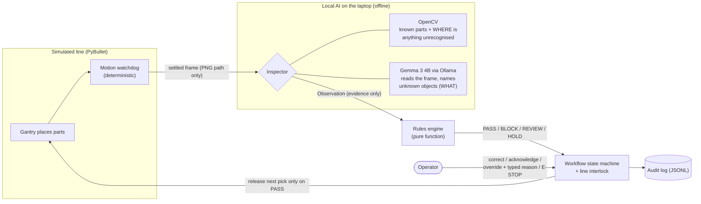

# HoloGuide

**Local AI assembly verification for the shop floor: the AI reports, deterministic rules decide, people stay in control.**

HoloGuide watches a simulated assembly line build a 4-step *Sealed Cover Assembly*: base plate → gasket → cover →
bolts. It catches mistakes before a unit moves on. Everything runs **offline on one laptop**: Gemma 3 4B is served
locally by Ollama, and nothing is downloaded or sent anywhere during operation.

It catches four kinds of mistake:

| Mistake | Example | Who catches it |
|---|---|---|
| Missing part | Cover placed with no gasket under it | AI evidence → rules |
| Wrong part | Green decoy cover instead of the blue one | AI evidence → rules |
| Wrong order | Gantry tries to place the cover at step 1 | **Order guard refuses the pick before anything moves** (no AI); a later part already in the image → AI evidence → rules |
| Foreign object | Screwdriver, wrench or rag left in the work area | OpenCV finds *where*, Gemma says *what* → rules |

Built for the GDG Windsor *Build with AI: Smart Automation, Robotics, and Vision* hackathon (DevFest 2026 track).
All results are on **synthetic PyBullet renders** by design.

## Architecture



**Core rules of the design**
- **The AI reports, the rules decide.** Inspectors return an `Observation` (parts seen, foreign objects, confidence,
  one-sentence rationale). Only the rules engine turns it into a `Decision`, and only the workflow advances a step.
- **Fixed rule priority:** foreign object → wrong order → wrong or decoy part → missing part → confidence threshold
  (0.70) → PASS. Any AI failure or timeout (20 s) gives **HOLD**. Low confidence gives **NEEDS REVIEW**.
  Neither can ever pass.
- **People stay in control.** Overrides need an operator ID and a typed reason. The **E-STOP** freezes the line at
  any time. Removing a verified part revokes its approval. Every event goes to the audit log.
- **Trust boundary:** the inspector only ever receives an image path and the step spec. Labels and simulator ground
  truth never reach the AI.

## What Gemma does

Gemma 3 4B (4-bit, about 2.9 GB of VRAM) has three jobs:

1. **Reads the frame** (`GemmaInspector`). It answers one yes/no question per colour; code maps the answers to parts.
   The prompt never says which step it is, so the model can't "see" what should be there.
2. **Names foreign objects** (`ForeignObjectIdentifier`). OpenCV finds pixels that match no known part, and Gemma
   is shown only a close-up crop of them. It answers tool, cloth, debris, part of the assembly, or unclear.
3. **Explains** (optional, text only).

You choose how much Gemma leads with an **inspector factory**:

| Factory | Who reads each frame | Notes |
|---|---|---|
| `src.vision.factories:gemma_first` | **Gemma reads every frame**; OpenCV can only send a disagreement to review | Default for the demo |
| `src.vision.factories:hybrid` | OpenCV reads every frame; Gemma for unclear parts and unknown objects | Fastest; default for evaluation |
| `src.vision.factories:gemma` | Gemma alone | Baseline, not safe on its own |
| `src.vision.factories:cv` | OpenCV alone | Baseline, can't name objects |

## Key results (real Gemma, measured)

Full tables, method, caveats and reproduce commands: **[`docs/decisions.md`](docs/decisions.md)**.

**Held-out dataset v3** (130 images: 40 correct, 10 of each original mistake type, 60 foreign objects):

| Inspector | Correct | Wrong order | Foreign object | False blocks | Mistakes that passed | Median latency |
|---|---:|---:|---:|---:|---:|---:|
| OpenCV alone | 100% | 100% | 0% (all 60 sent to review) | 0% | 0 | 0.016 s |
| Gemma alone | 85% | 60% | 47% | 15% | **36** | 2.8 s |
| **Hybrid** | **100%** | **100%** | **100%** | **0%** | **0** | 0.024 s |
| Gemma-first | 85% | 60% | 100% | 0% | **0** (11 images sent to review overall) | 3.0 s |

**20-unit simulated shift on the live line** (seed 2026, 8 injected faults, scripted operator):

| Inspector | Faults caught | Escaped | False stops | Mean cycle | Units/hour (simulated) |
|---|---:|---:|---:|---:|---:|
| Hybrid | 8/8 | 0 | 0 | 7.8 s | 462 |
| Gemma-first | 8/8 | 0 | 0 | 19.6 s | 184 |

**What this shows:** Gemma alone isn't safe enough to decide, and OpenCV alone can't tell what an unknown object is.
Combined under deterministic rules, no mistake image passed on either dataset. Gemma's object *names* are a hint
for the operator (right in 28 of 60 cases); the *block* doesn't depend on them.

## Quick start

Requires Python 3.10+, [Ollama](https://ollama.com), and an NVIDIA GPU for interactive speed. CPU works, more slowly.

```bash
python3 -m venv .venv
.venv/bin/python -m pip install -r requirements.txt
ollama pull gemma3:4b                 # once, while online; the demo never downloads anything
.venv/bin/python -m pytest -q         # 282 tests, no GPU or Ollama needed
```

On Windows, use `.venv\Scripts\python.exe` in place of `.venv/bin/python`.

### Run the demo (dashboard, Real mode)

```bash
bash scripts/run_video_demo.sh        # checks Ollama + model, warms Gemma, runs the offline self-test, opens the dashboard
HOLOGUIDE_INSPECTOR_FACTORY=src.vision.factories:hybrid bash scripts/run_video_demo.sh   # faster hybrid
```

In the browser: **Operation → Real → Start selected mode / reset session**, then go to the **Live line monitor**:

- **Single scenario:** `correct`, `missing_gasket`, `wrong_cover`, `wrong_order` or `foreign_object`. When the line
  stops, enter an operator ID and choose the action shown: correct the fault, acknowledge, override with a reason,
  or clear a hold.
- **Whole shift:** N units with seeded random faults and a live KPI board (faults caught / escaped / false stops /
  units per hour).
- **E-STOP:** freezes the gantry. Releasing it needs an operator ID and a typed reason.
- **Simulate AI outage:** Gemma becomes unreachable. The line stops for review or hold and never passes.
- **Offline self-test badge:** checks that the endpoint is on localhost, that the model is on disk, and that there
  is no internet route. With Wi-Fi off it shows **OFFLINE VERIFIED**.

### Command line

```bash
# Live line, all 5 scenarios -> MP4 with overlays (operator actions scripted and labelled on screen)
.venv/bin/python -m src.simulation.live_monitor --inspector-factory src.vision.factories:hybrid --output outputs/live/run1

# A 20-unit shift -> MP4 + KPIs
.venv/bin/python -m src.simulation.live_monitor --shift 20 --seed 2026 \
    --inspector-factory src.vision.factories:gemma_first --output outputs/live/shift1

# Generate a labelled dataset and evaluate an inspector on it
.venv/bin/python -m src.simulation.dataset --output outputs/dataset-v3 --randomize --seed 3030 \
    --correct 40 --per-fault 10 --foreign 60
.venv/bin/python -m src.evaluation.runner outputs/dataset-v3/labels.csv \
    --inspector-factory src.vision.factories:hybrid --model gemma3:4b --output outputs/evaluation/hybrid-v3.csv
```

Output paths must be new, because the tools never overwrite earlier runs. Each evaluation writes a CSV, a summary,
tables and a provenance file (dataset and image hashes, config, code revision, model and package versions).
Generated files live in `outputs/`, which is git-ignored.

### Notebook

[`notebooks/hologuide_demo.ipynb`](notebooks/hologuide_demo.ipynb) walks through the whole pipeline with saved
real-Gemma outputs: inspection, rules, workflow and audit log, edge cases, foreign objects, the live-line shift, and
the results tables. On Kaggle it clones this repo by itself. Gemma cells show N/A where there is no local Ollama.

## Project layout

```
config/assembly.yaml       parts, steps, camera, confidence threshold (0.70), AI timeout (20 s)
src/simulation/            PyBullet scene, scenarios, dataset generator, live line monitor + shift
src/vision/                OpenCV, Gemma, Hybrid, Gemma-first inspectors; foreign-object identifier; AI-outage switch
src/control/               rules engine, workflow state machine, audit log
src/dashboard/             Streamlit dashboard, live line panel, offline self-test
src/evaluation/            evaluation runner, metrics, provenance, reports
tests/                     282 tests (no GPU or Ollama needed)
docs/decisions.md          measured results, design decisions, reproduce commands
```

## Limitations

- Simulation only. The renders are clean, and the OpenCV thresholds are tuned to them, so a physical camera
  would need recalibration.
- The gantry is an animation, not a physics-based robot. Faults are scripted mis-picks.
- Cycle times are *simulated* line time: they show relative cost, not a real factory rate.
- The operator identifier is free text, with no login.
- Gemma's foreign-object names are hints (28/60 correct). The block depends only on the object kind.

## Team

| Partner | Area |
|---|---|
| Partner 1 | Simulation, datasets, scenarios, demo ([technical notes](docs/PARTNER1_TECHNICAL.md)) |
| Partner 2 | Vision and local AI inspection ([vision module](docs/VISION_MODULE.md)) |
| Partner 3 | Rules, workflow, audit ([final report](docs/FINAL_PARTNER3_REPORT.md)) |
| Partner 4 | Dashboard and evaluation |

The plan and task IDs are in [`HOLOGUIDE_ROADMAP.md`](HOLOGUIDE_ROADMAP.md). Contributor notes for AI coding
assistants are in [`CLAUDE.md`](CLAUDE.md).
