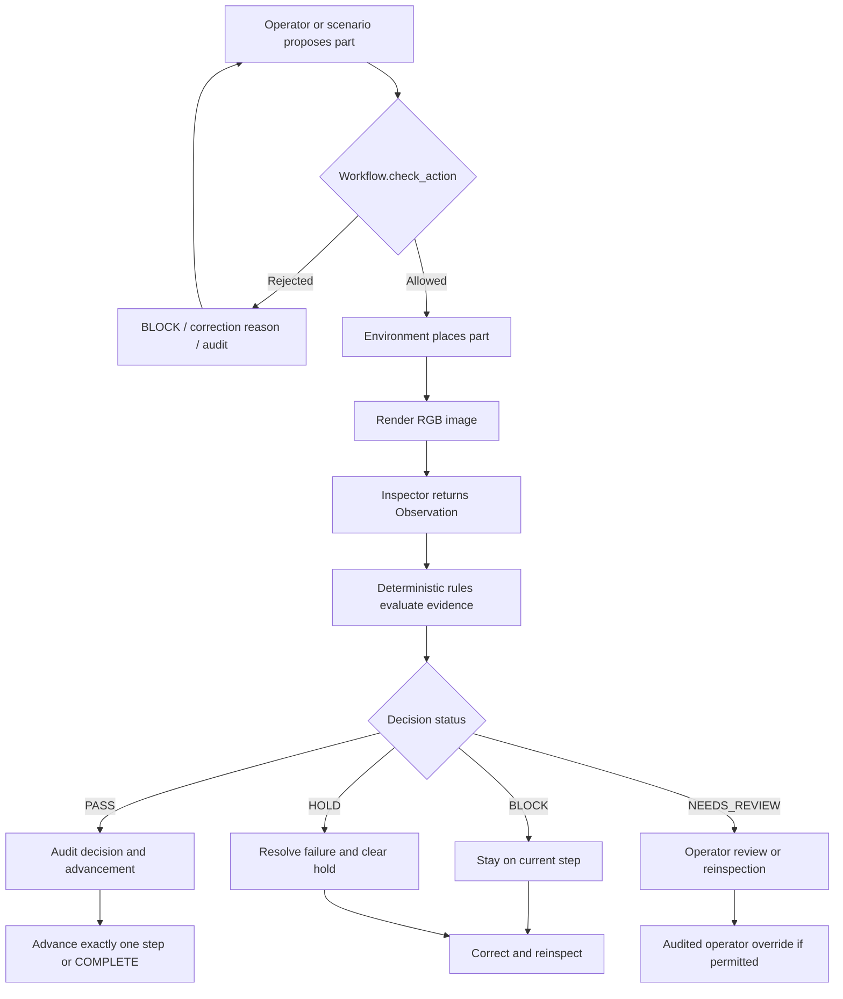

# HoloGuide Partner 3 Final Report

**Area:** Deterministic control, workflow safety, audit, and control CLI

**Verification date:** November 9, 2026

**Verified code baseline:** `5c925cda5f3d1f3ef083122cedd7e15b70749fa3` (`origin/main`)

**Control CLI merge:** [PR #5](https://github.com/OmarElkott/HoloGuide/pull/5), containing `e7a1aa0605fe464b73608f9cbb6539aae851bd0a`

**Scope of evidence:** Local unit/integration tests and PyBullet images inspected by the OpenCV inspector

## 1. Executive summary

Partner 3 delivered HoloGuide's authorization boundary: configuration-driven rules, a stateful workflow,
an order guard, safe failure and retry handling, audited operator intervention, append-only JSONL events,
and mock and real command-line workflows. The control layer consumes a structured visual
`Observation`; it alone creates the `Decision` that can change assembly progress.

The central safety rule is **AI reports; rules decide**. Inspector confidence and part reports are evidence,
not commands. Free-form model rationale is never parsed as authorization. A step advances only after a
deterministic PASS or a permitted operator approval whose audit event was written before state mutation.
BLOCK, NEEDS_REVIEW, and HOLD never advance the step.

Status at this verification point:

- **Implemented:** All mandatory Partner 3 control tasks in the roadmap.
- **Verified by tests:** 93 targeted control tests and 219 complete-project tests passed.
- **Verified through real simulation:** All four scenarios completed using PyBullet-rendered PNGs and the
  OpenCV inspector; fault scenarios first blocked, then corrected and reinspected.
- **Pending human/manual verification:** Final dashboard usability and offline presentation rehearsal.
- **Future/optional:** `py_trees` rendering and audit JSONL-to-CSV export.

This is a simulation prototype, not a certified industrial safety system. The real-scenario evidence proves
the integrated software path on controlled synthetic renders. It does not establish accuracy or reliability
on physical factory cameras, uncontrolled lighting, arbitrary products, or safety-critical machinery.

## 2. Purpose and architecture

The control system separates perception from authority. Simulation or a dashboard proposes an action and
renders a camera image. An inspector converts only that image and the current step into an `Observation`.
Deterministic rules convert the observation into a `Decision`. `Workflow` applies the authorized transition
and writes the required audit records.



The major implementation files are:

| File | Responsibility |
|---|---|
| `src/control/rules.py` | Pure `Observation` to `Decision` authorization rules |
| `src/control/workflow.py` | State, order guard, advancement, retries, holds, overrides, invalidation |
| `src/control/audit_log.py` | Append-only JSONL persistence and serialization |
| `src/control/cli.py` | Explicit mock mode and real PyBullet/inspector integration |
| `src/config.py` | Validated assembly, parts, steps, threshold, and camera configuration |
| `src/vision/schemas.py` | Shared `Observation`, `Decision`, and enum contracts |

## 3. Contracts: evidence in, authorization out

### Configuration

`AssemblyConfig` loads `config/assembly.yaml` and validates duplicate part names, step references, and
consecutive step IDs. `expected_parts(step_id)` accumulates every part required through the selected step.
Control therefore does not hardcode the four-step order in its rules or workflow.

The current assembly has a `0.70` confidence threshold and these ordered additions:

1. `base_plate`
2. `gasket`
3. `cover`
4. `bolts`

`wrong_cover` is configured as a decoy rather than a valid assembly step part.

### Observation

The shared Pydantic `Observation` contains:

- `parts_detected: list[str]`
- `missing_parts: list[str]`
- `wrong_parts: list[str]`
- `confidence: float` constrained to `[0, 1]`
- `rationale: str`

The rationale is displayed to people but is not used by the rules to grant authorization. The inspector
receives the image path and current `StepSpec`; dataset labels and simulator `parts_present()` are not
inspection arguments.

### Decision

The shared Pydantic `Decision` contains the step, status, message, decision source, optional observation,
and a timezone-aware timestamp. Status is one of `pass`, `block`, `needs_review`, or `hold`.
`decided_by` distinguishes `rule`, `operator`, and `system` decisions.

### Order-guard result

`ActionCheck` is an immutable typed result containing:

- `allowed` and convenience `blocked`/boolean behavior
- a human-readable `reason`
- the proposed `part`
- the relevant `current_step`
- whether reinspection is required
- the earliest step invalidated by a protected-part change

## 4. Deterministic rule precedence

`evaluate()` validates the observation and applies fail-safe precedence. Earlier findings win:

1. A detected future-step part produces BLOCK for incorrect order.
2. A reported wrong part, detected decoy, or unconfigured detected part produces BLOCK.
3. An independently reported missing required part produces BLOCK.
4. Zero-confidence evidence with no earlier hard violation produces HOLD.
5. A required part absent from otherwise adequate-confidence detections produces BLOCK.
6. Contradictory evidence, where a part is both detected and reported missing, produces NEEDS_REVIEW.
7. An unconfigured name in `missing_parts` produces NEEDS_REVIEW.
8. Confidence below the configured threshold produces NEEDS_REVIEW.
9. A final structural missing-part guard prevents PASS if any cumulative requirement remains absent.
10. Only consistent, sufficiently confident, complete evidence produces PASS.

Hard visual violations precede generic confidence handling. For example, a clearly reported wrong part is
blocked even if the same observation has zero confidence. In the rendered `missing_gasket` scenario, a
premature cover is also visible; future-part precedence truthfully reports incorrect order before the more
general missing-part condition.

Rule output is deterministic apart from the Decision timestamp. Repeating the same validated evidence,
step, threshold, and configuration yields the same status and correction message.

## 5. Workflow states and transitions

The states are `WAITING`, `INSPECTING`, `BLOCKED`, `NEEDS_REVIEW`, `HOLD`, `STEP_COMPLETE`, and
`COMPLETE`.

| From | Trigger | Result | Step movement |
|---|---|---|---|
| WAITING/BLOCKED/NEEDS_REVIEW/STEP_COMPLETE | inspection requested | INSPECTING | None |
| INSPECTING | rule PASS | STEP_COMPLETE or COMPLETE | Exactly one step, or terminal completion |
| INSPECTING | rule BLOCK | BLOCKED | None |
| INSPECTING | low/conflicting evidence | NEEDS_REVIEW | None |
| INSPECTING | inspection/audit failure | HOLD | None |
| HOLD | `clear_hold(operator, reason)` | WAITING, or NEEDS_REVIEW at retry limit | None |
| BLOCKED/NEEDS_REVIEW | approved operator override | STEP_COMPLETE or COMPLETE | Exactly one step |
| BLOCKED/NEEDS_REVIEW | rejected operator override | BLOCKED | None |
| Verified later step/COMPLETE | explicit `invalidate_part` | WAITING at originating step | Rollback only |
| COMPLETE | inspection/override attempt | error/rejection | None |

`STEP_COMPLETE` represents a successful non-final transition after the current-step index has already moved
to the next step. A subsequent accepted current-step action returns the state to WAITING. At COMPLETE, the
reported current step remains the final configured step, but no further advancement is possible.

The workflow rejects inspection in illegal states, after a blocking order-guard result until a current-step
action is accepted, and after retry escalation until operator action resolves it.

## 6. Assembly advancement and order guard

The required caller sequence is:

```python
check = workflow.check_action(part)
if not check.allowed:
    show_correction(check.reason)
    return

environment.place_part(part)
image_path = environment.render_to_file(...)
decision = workflow.request_inspection(image_path)
```

The guard runs before physical placement and before inspector invocation because visual inspection is too
late to prevent an invalid action and may be slow or unavailable. It rejects:

- unknown names;
- configured decoys;
- parts assigned to later steps;
- previously verified parts that have not first been invalidated;
- unsafe duplicate actions;
- actions during INSPECTING or HOLD; and
- all new actions after COMPLETE.

A normal guard rejection records `action_rejected`, sets BLOCKED, and prevents inspection until the correct
current-step action is accepted. Rejections made while COMPLETE, INSPECTING, HOLD, or for a duplicate
preserve the safer existing state. A successful guard audit occurs before the action becomes accepted; if
that audit write fails, acceptance does not occur.

The rendered scenario runner deliberately bypasses normal placement only to inject known physical faults for
testing. Those injections use `simulation_fault_injected` audit events. They are not authorization paths and
their scripted `present` set is never passed to the inspector.

## 7. Fault, confidence, hold, and retry behavior

### Missing, wrong, and out-of-order parts

- Missing cumulative required evidence: BLOCK with an add-and-reinspect message.
- Wrong, decoy, or unknown detected part: BLOCK with a remove-and-reinspect message.
- Future-step part: BLOCK with an order-specific correction.
- None of these decisions advance the step.

### Low or contradictory confidence

Evidence below `confidence_threshold` goes to NEEDS_REVIEW rather than becoming an automatic pass or being
mislabelled as a timeout. Contradictory evidence also requires review. At exactly `0.70`, otherwise complete
evidence meets the current threshold.

### Inspection failure and HOLD

Inspector exceptions, malformed returned observations, and zero-confidence failure evidence cannot pass.
The workflow creates a system HOLD decision and stays on the current step. HOLD cannot be overridden.
`clear_hold` requires an operator identifier and reason, writes its audit event before changing state, and
does not approve the step. A fresh inspection remains necessary.

### Retry limit

The configurable default is three consecutive unsuccessful inspections for the current step. Non-HOLD
failure at the limit escalates to NEEDS_REVIEW. A real failure remains HOLD first; clearing the final hold
moves to NEEDS_REVIEW. Further automatic inspection is then refused until an operator decision. Successful
advancement, an operator decision, or explicit invalidation resets the counter.

## 8. Operator override

`operator_override(approve, reason, operator)` is an explicit application API, never an interpretation of
model text. It is permitted only from BLOCKED or NEEDS_REVIEW.

Required controls:

- `approve` must be a boolean;
- operator and reason must be nonempty after trimming;
- HOLD and COMPLETE cannot be overridden;
- an audit sink is mandatory;
- the complete `operator_override` authorization event is written before mutation;
- approval advances exactly one step or completes only the final step;
- rejection remains on the current step in BLOCKED; and
- the returned Decision uses `decided_by=operator`.

The operator identifier is currently a supplied string, not an authenticated identity. Override is therefore
auditable but not a substitute for production authentication or role-based access control.

## 9. Verified-part invalidation and reinspection

A caller must invoke `invalidate_part(part, reason, actor)` before removing or replacing a previously
verified component. The workflow records `approval_invalidated` before mutation, rolls back to the part's
originating step, clears accepted actions and retry state, discards the old last decision, and requires the
affected step and every later step to be inspected again.

The dashboard follows this policy before environment removal. If physical removal later fails, the workflow
remains conservatively invalidated rather than silently preserving an approval for an uncertain scene.

## 10. Authorization and audit invariant

Required audit persistence is part of transition authorization:

- action acceptance is recorded before it becomes accepted;
- inspection request is recorded before the inspector is called;
- PASS and step advancement/completion are recorded before workflow mutation;
- override, hold clearing, and invalidation are recorded before mutation.

If decision auditing fails, a proposed PASS is replaced with a system HOLD and cannot advance. If the audit
sink itself is unavailable, the failure-HOLD event cannot be persisted to that same broken sink; the returned
decision and in-memory state still fail safe, and external repair of logging is required.

## 11. Append-only JSONL audit

`AuditLog.record()` creates missing parent directories and appends exactly one compact JSON object plus a
newline per event. It never rewrites earlier events. Every event receives an ISO 8601, timezone-aware UTC
timestamp and an `event_type`. Pydantic models, enums, aware timestamps, dates, paths, dataclasses, mappings,
and collections are converted to JSON-compatible values. Non-finite numbers and naive timestamps are
rejected. Missing or empty files read as an empty list; malformed data and I/O failures raise `AuditLogError`.

Illustrative event shape, with no private path or operator data:

```json
{"timestamp":"2026-11-09T20:00:00+00:00","event_type":"inspection_passed","current_step":{"id":1,"name":"Place base plate","instruction":"Place the grey base plate on the work surface.","adds_parts":["base_plate"]},"workflow_state":"inspecting","next_state":"step_complete","decision":{"step_id":1,"status":"pass","message":"Step 1 verified: Place base plate. Continue to the next step.","decided_by":"rule","observation":{"parts_detected":["base_plate"],"missing_parts":[],"wrong_parts":[],"confidence":0.95,"rationale":"Visual evidence summary."},"timestamp":"2026-11-09T20:00:00+00:00"},"observation":{"parts_detected":["base_plate"],"missing_parts":[],"wrong_parts":[],"confidence":0.95,"rationale":"Visual evidence summary."},"inspection_attempts":0,"retry_limit":3}
```

Significant workflow events include:

- `action_accepted`, `action_rejected`
- `inspection_requested`, `inspection_passed`, `inspection_blocked`
- `inspection_needs_review`, `inspection_hold`
- `retry_limit_reached`, `hold_cleared`
- `step_advanced`, `assembly_completed`
- `operator_override`, `approval_invalidated`

Scenario/dashboard integrations additionally record starts, stops, corrections, deliberate fault injection,
and physical removal events. The current log uses an in-process thread lock; it is not a cryptographically
signed, tamper-evident, or multi-process transactional ledger.

## 12. CLI and integration boundaries

### Mock mode

Mock mode writes explicitly labelled JSON scene snapshots and uses a deterministic fixture inspector. It
exercises the production Workflow, rules, and audit code without claiming PyBullet, AI inference, accuracy,
or latency.

```powershell
python -m src.control.cli --scenario missing_gasket --mode mock
```

### Real mode

Real mode lazily loads the existing PyBullet `AssemblyEnv`, delegates scenario orchestration to
`ScenarioRunner`, and defaults to `src.vision.factories:cv`. It renders PNG images and passes those image
paths to the inspector. Completion is printed only when both `RunResult` and `Workflow.state` report a clean
COMPLETE. Exit code 0 means completion, 1 means safe non-completion, and 2 means argument/configuration/
dependency/setup failure.

```powershell
python -m src.control.cli --scenario correct --mode real
python -m src.control.cli --scenario missing_gasket --mode real
python -m src.control.cli --scenario wrong_cover --mode real
python -m src.control.cli --scenario wrong_order --mode real
```

`--inspector-factory module:function` can select another installed inspector. Gemma or a Hybrid fallback
requires a separately provisioned local Ollama model; the CLI never downloads one.

### Cross-team integration

- **Simulation:** Control calls the guard before normal `place_part`, inspects rendered PNGs, and never uses
  `parts_present()` as visual evidence.
- **Vision:** Inspectors implement `inspect(image_path, step) -> Observation`. A step-ID adapter exists for
  older compatible inspectors.
- **Dashboard:** `DashboardSession` calls `check_action`, `request_inspection`, `operator_override`,
  `clear_hold`, and `invalidate_part`; it does not mutate the workflow step directly.
- **Evaluation:** Control decisions can be scored externally, but evaluation labels remain outside the
  inspector and workflow input.

## 13. Automated safety evidence

### Commands and results

Targeted control verification:

```powershell
.\.venv\Scripts\python.exe -m pytest -q tests/test_config.py tests/test_rules.py tests/test_audit_log.py tests/test_workflow.py tests/test_workflow_safety.py tests/test_cli_integration.py
```

Result: **93 passed in 5.47 seconds; 0 failed; 0 skipped.**

Complete repository verification:

```powershell
.\.venv\Scripts\python.exe -m pytest -q
```

Result: **219 passed in 26.32 seconds; 0 failed; 0 skipped.**

Coverage includes:

- cumulative missing-part, wrong-part, decoy, unknown-part, and future-part rules;
- threshold boundaries, contradictions, zero confidence, and rationale non-authority;
- legal state progression and terminal behavior;
- guard-before-inspector and no progression after rejection;
- duplicate and repeated invalid actions;
- explicit invalidation and required reinspection;
- append ordering, UTC timestamps, serialization, malformed reads, and write failure;
- audit failures before action, inspection, PASS, override, hold exit, and invalidation;
- hold clearing, retry escalation, and counter reset;
- approved/rejected operator override restrictions;
- all mock and real CLI scenarios; and
- a seeded (`20261028`) 500-operation randomized invariant test proving that every observed forward step
  followed an audited rule PASS or an audited operator PASS, with no skipped steps.

## 14. Real PyBullet and OpenCV scenario evidence

The four commands below were executed from the repository root using fresh audit and frame paths under the
system temporary directory. The inspector was the real OpenCV factory wrapped by the configured timeout;
Ollama/Gemma was not used.

| Scenario | Exit | Decision sequence | Guard/recovery | Final result | Frames | Audit events |
|---|---:|---|---|---|---:|---:|
| `correct` | 0 | pass, pass, pass, pass | No injected fault | COMPLETE | 4 | 18 |
| `missing_gasket` | 0 | pass, block, pass, pass, pass | Corrected and reinspected | COMPLETE | 5 | 23 |
| `wrong_cover` | 0 | pass, pass, block, pass, pass | Corrected and reinspected | COMPLETE | 5 | 23 |
| `wrong_order` | 0 | block, pass, pass, pass, pass | Guard rejected the premature action before inspection; rendered fault then recovered | COMPLETE | 5 | 24 |

Commands executed (the temporary root contained only generated evidence and was not committed):

```powershell
$evidenceRoot = Join-Path $env:TEMP 'hologuide-p3-evidence-d6c3bad1452a42a78951b6ce034838e4'

.\.venv\Scripts\python.exe -m src.control.cli --scenario correct --mode real `
  --audit-path "$evidenceRoot\correct-audit.jsonl" --frames-dir "$evidenceRoot\correct-frames"
.\.venv\Scripts\python.exe -m src.control.cli --scenario missing_gasket --mode real `
  --audit-path "$evidenceRoot\missing_gasket-audit.jsonl" --frames-dir "$evidenceRoot\missing_gasket-frames"
.\.venv\Scripts\python.exe -m src.control.cli --scenario wrong_cover --mode real `
  --audit-path "$evidenceRoot\wrong_cover-audit.jsonl" --frames-dir "$evidenceRoot\wrong_cover-frames"
.\.venv\Scripts\python.exe -m src.control.cli --scenario wrong_order --mode real `
  --audit-path "$evidenceRoot\wrong_order-audit.jsonl" --frames-dir "$evidenceRoot\wrong_order-frames"
```

These runs verify integration and expected control behavior on synthetic images. They are not measurements
of physical-world vision accuracy. Recovery time was not used as a performance claim in this report.

## 15. Verification environment

| Item | Verified value |
|---|---|
| Code baseline | `5c925cda5f3d1f3ef083122cedd7e15b70749fa3` |
| Python | 3.11.0 |
| pytest | 9.2.0 |
| Pydantic | 2.14.1 |
| PyYAML | 6.0.3 |
| PyBullet | 3.2.7 |
| NumPy | 2.4.6 |
| Pillow | 13.0.0 |
| OpenCV Python | 5.0.0.93 |
| Ollama Python package | 0.6.3 |
| Streamlit | 1.66.1 |

The local Ollama HTTP service at `localhost:11434` timed out during verification. No Gemma execution or
Gemma validation is claimed. No automated verification was skipped.

## 16. Known limitations and remaining dependencies

### Implemented but bounded

- Workflow and retry state are in memory; process restart recovery is not implemented.
- Audit JSONL is append-only by API convention, not cryptographically tamper-evident.
- The audit lock is in-process only; multiple processes writing one file are not coordinated.
- Operator identifiers and reasons are required strings but are not authenticated identities.
- Control trusts callers to obey guard-before-environment-mutation. The dashboard and scenario runner do;
  Python cannot prevent unrelated code from directly calling an environment.
- Invalidation and physical removal are conservatively ordered but are not one atomic transaction.
- ScenarioRunner's four demonstrations are specific to the current sealed-cover assembly.

### Pending human/manual verification

- Final real-dashboard visual/usability review at presentation resolution.
- Full Wi-Fi-disabled rehearsal and final demonstration recording.
- Human review of messages, operator procedures, and evidence retention policy.

### Cross-team or future work

- Restore Ollama and separately validate Gemma/Hybrid behavior if those inspectors will be demonstrated.
- Validate on real camera images before making physical-factory claims.
- Add authentication/roles and durable workflow recovery for production use.
- Optional `CTL-12` `py_trees` rendering was not implemented; this Mermaid diagram documents the flow.
- Optional `CTL-13` JSONL-to-CSV export was not implemented; JSONL remains the authoritative audit format.

## 17. Original Partner 3 task status

Status terms are deliberately separated: implementation is code presence, test verification is automated
evidence, and real-simulation verification is PyBullet + OpenCV execution.

| ID | Final status | Evidence / qualification |
|---|---|---|
| `SCH-01` | Implemented, test-verified | Shared Observation/Decision contracts remain Pydantic models and were not expanded for control-only errors |
| `CTL-01` | Implemented, test-verified | Seven workflow states, legal transitions, exact one-step advancement, terminal checks |
| `CTL-02` | Implemented, test-verified, real-sim exercised | Deterministic rules produce Decision from Observation/config context |
| `CTL-03` | Implemented, test-verified, real-sim exercised | Missing, wrong, order, uncertainty, failure, and pass messages |
| `CTL-04` | Implemented, test-verified | Below-threshold evidence enters NEEDS_REVIEW; threshold boundary tested |
| `CTL-05` | Implemented, test-verified, real-sim exercised | Typed guard rejects premature parts before inspector; wrong-order real run confirms ordering |
| `CTL-06` | Implemented, test-verified | Inspection failure enters HOLD; audited clearing never approves and requires reinspection |
| `CTL-07` | Implemented, test-verified | Approve/reject limited to blocked/review states with identity, reason, and pre-mutation audit |
| `CTL-08` | Implemented, test-verified, real-sim exercised | Append-only UTC JSONL with explicit I/O errors and structured serialization |
| `CTL-09` | Implemented, test-verified | Configurable retry limit and NEEDS_REVIEW escalation without bypassing HOLD |
| `CTL-10` | Implemented, test-verified, real-sim exercised | Mock and real CLI; real adapter merged through PR #5 and delegates to ScenarioRunner |
| `CTL-11a` | Complete | Rules, guard, audit, state, failure, and serialization unit tests |
| `CTL-11b` | Complete | Mock full-loop and real PyBullet/OpenCV integration tests |
| `EVL-04` | Complete, test-verified | Seeded 500-operation no-unauthorized-advancement invariant |
| `CTL-14` | Implemented for current scope | Typed public results/protocols, docstrings, obsolete real-CLI placeholder removed; no formal static-type run claimed |
| `DOC-03e` | Complete in this report | Control logic, safety boundary, evidence, limitations, and override documented |
| `CTL-12` | Not implemented; optional/future | No `py_trees` dependency/view; Mermaid flow supplied instead |
| `CTL-13` | Not implemented; optional/future | No CSV exporter; dashboard can expose/download JSONL |

## 18. Final conclusion

Partner 3's mandatory control scope is implemented and verified. The system's strongest property is not that
an inspector is always correct; it is that visual evidence cannot directly mutate assembly progress. The
guard, deterministic decision rules, workflow transition checks, audit-before-authorization behavior, retry
limit, HOLD recovery, invalidation policy, and constrained manual override jointly provide a clear and
testable safety boundary for the HoloGuide prototype.
