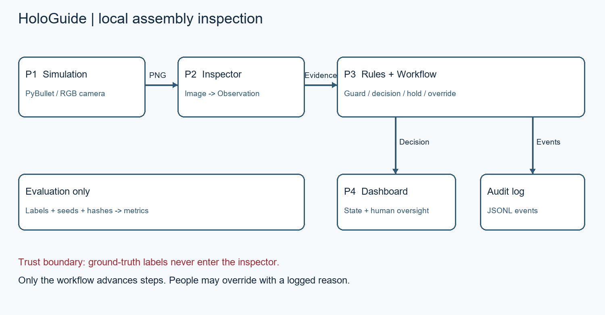

# Partner 1: simulation and evaluation setup

HoloGuide renders a static assembly in PyBullet DIRECT mode with TinyRenderer. Four assembly steps add a grey base plate, orange gasket, blue cover and four red bolts. A green decoy is a wrong cover. The gasket is wider than the cover and the bolts sit outside its footprint, preserving visible evidence. Components are static bodies; this is an assembly inspection prototype, not a validated dynamics or manufacturing simulator.

## Architecture and trust boundary



The simulation sends an RGB PNG to the inspector. The inspector returns a validated Observation. Partner 3's rules and Workflow alone authorize advancement; the runner never writes the current step and never overrides a failed decision. The dashboard renders that state and its audit trail. Dataset CSV labels and simulator part state are evaluation ground truth and never inspector arguments. The existing mock CLI intentionally reads JSON fixtures; it must not be mistaken for the rendered-image pipeline.

## Dataset protocol

`python -m src.simulation.dataset --output outputs/dataset-v1 --seed 2026`

`python -m src.simulation.dataset --output outputs/dataset-v2 --seed 2026 --randomize`

Each command generates 200 PNGs: 80 correct, 40 missing-part, 40 wrong-part and 40 visible-future-part cases. Correct and missing cases span all four steps; wrong-part cases introduce the green decoy, replacing the cover when present. Wrong-order cases span steps 1–3 because step 4 has no future part. A still image cannot establish historical action order. Report this category as visible out-of-order parts, separately from the action guard.

The labels.csv fields include image_path (relative to the CSV), step_id, mistake_type, expected_status, seed, parts_present and SHA-256. This directly satisfies Partner 4's evaluation runner. Images use numeric filenames and contain no labels or metadata with the answer. dataset.json records configuration and seed. Output directories must be new; partial failed runs remain available for diagnosis and must not be treated as complete datasets.

V1 is a fixed-scene regression dataset: repetitions are intentional and do not constitute independent visual diversity. V2 changes yaw ±3 degrees, pitch ±2 degrees, light direction and component XY offsets ±3 mm, using a local NumPy generator. Reset repeats the seed. Determinism is checked within the installed PyBullet/platform stack; byte equality across versions or machines is not promised. Do not split duplicate V1 frames across tuning and evaluation. For independent V2 evaluation, use a disjoint seed range and compare image hashes.

## Scenario and recovery protocol

`python -m src.simulation.runner --scenario missing_gasket --output outputs/scenario-001 --inspector-factory src.vision.factories:cv`

`src.vision.factories:cv` is Partner 2's installed OpenCV factory (no GPU or model server required). Use `src.vision.factories:gemma` or `:hybrid` only with a provisioned local model. It takes no arguments and returns an inspector. The production workflow calls inspect(path, StepSpec). Add `--step-id-interface` for the roadmap inspect(path, step_id) contract. No inspector implementation is inferred or silently substituted.

The four scenarios use a fresh environment and workflow. Correct verifies each of four steps. Missing gasket verifies the base, physically places a premature cover, requires BLOCK, removes the cover, inserts the gasket and continues. Wrong cover verifies base and gasket, injects the decoy, requires BLOCK, replaces it and continues. Wrong order first checks the guard without invoking inspection, then explicitly injects the cover to test the visual path; after BLOCK it removes the cover and continues. These physical injections are deliberate test operations, logged separately from authorized placement. Fault cases stop on unexpected PASS, HOLD or Needs Review; they never force completion. Playback is bounded and advances one inspection per tick.

`python -m src.evaluation.recovery --output outputs/recovery-real-001 --inspector-factory src.vision.factories:cv --runs 20 --seed 50000 --evidence real-inspector`

Run this only with the actual inspector. It produces 80 trials, including 20 correct controls and 20 of each fault. Recovery means an observed BLOCK followed by correction and PASS; completion is recorded separately. recovery_s measures from the blocking decision to the correction pass, including correction, rendering and inspection. It is not model-only latency. All attempts, failures, seeds, decisions and per-trial audits are retained. Evidence classification is a caller declaration: verify the factory and provenance before publishing any results.

For image-level evaluation reuse Partner 4:

`python -m src.evaluation.runner outputs/dataset-v2/labels.csv --output outputs/eval-real.csv --inspector-factory src.vision.factories:cv`

Without a real factory that command defaults to the existing JSON mock, which cannot inspect PNGs. Always specify the factory for these datasets.

## Dashboard integration

In PowerShell:

```powershell
$env:HOLOGUIDE_BACKEND_FACTORY = 'src.simulation.backend:create_session'
$env:HOLOGUIDE_INSPECTOR_FACTORY = 'src.vision.factories:cv'
# Only if Partner 2 implements inspect(path, step_id):
$env:HOLOGUIDE_STEP_ID_INTERFACE = '1'
python -m streamlit run src/dashboard/app.py
```

Select Real and start/reset the session. Load a scenario before placing any parts, then play each step. The launcher uses the same runner as CLI/evaluation. Start a fresh session for another scenario. Existing mock Demo Mode remains explicitly mock and is separate from real scenario playback. Model/endpoint display can be configured with HOLOGUIDE_MODEL_NAME and HOLOGUIDE_MODEL_ENDPOINT; these labels do not monitor network traffic.

## Optional fault and visuals

`env.offset_part('cover', 0.05, 0)` injects a misalignment without changing its identity; all bodies belonging to a component move together. This is a geometry capability, not an implemented vision alignment detector. Presence-only inspectors may pass it. Use it as a qualitative demo only until Partner 2 supplies alignment evidence and the team agrees on labels/rules. Existing configured colors, unobstructed gasket rim, external bolt positions and neutral workstation are preserved. Cosmetic text must remain outside inspection PNGs; the dashboard already labels steps and parts.

## Measured OpenCV validation — November 8, 2026

The integrated PR #4 head `575d5b09f5137285d23e9460145d7a32027ff8a6` passed 222 tests before the final documentation/video additions. Actual OpenCV inspection used `src.vision.factories:cv`, which wraps CVInspector in TimeoutInspector. No scripted observation inspector was used for these measurements.

| Dataset | Images | Exact decision agreement | False blocks | Errors/timeouts | Median / p95 evaluation time |
|---|---:|---:|---:|---:|---|
| Fixed V1 | 200 | 200/200 | 0/80 | 0/0 | 11.01 / 12.71 ms |
| Randomized V2 | 200 | 200/200 | 0/80 | 0/0 | 10.55 / 11.61 ms |

Each dataset has 80 correct and 40 of each fault category. These are existing synthetic regression datasets, not a newly held-out physical-camera benchmark. V1 includes repeated images. Latency covers inspection, validation and rules, excluding rendering and output writes. The results do not establish Gemma accuracy or GPU performance.

Recovery used 20 trials per scenario with seeds 2026–2045 and randomized rendering. Correct completed 20/20; missing_gasket, wrong_cover and wrong_order each blocked, recovered and completed 20/20, with zero errors. Thus 80/80 assemblies completed and 60/60 fault trials recovered. Correct controls are not counted as recovery. Repeated randomized simulated trials do not establish generalization to real manufacturing.

Raw CSVs, summaries, provenance, all trial PNGs and JSONL audits are in `outputs/nov8-verification/`, supplied separately because outputs are ignored by Git. The companion evidence archive includes the evaluated dataset images and labels. Keep that archive with any published results. P2's separate Gemma/Hybrid results have not been independently reproduced here. The local Ollama endpoint was unavailable; no model was downloaded.

## Dashboard and recording acceptance

The integrated live PyBullet/OpenCV demo controller passes automated tests, including the four scenarios and explicitly injected review/timeout stages. Visual browser acceptance remains pending: the computer-use browser permission blocked localhost access. This is not evidence of a dashboard failure. Wi-Fi-off rehearsal, microphone test and final narrated recording remain human acceptance steps.

The earlier scripted rehearsal remains available via `python -m src.simulation.rehearsal --output outputs/rehearsal-new`. It is explicitly a test-double demonstration and must not be used for AI performance claims.

Recovery trials now write each CSV row immediately and flush it to disk. Factory failures are retained as failed trials instead of aborting the entire run; provenance is written before trials begin and the final summary separates correct controls from fault recovery. A fresh inspector returned by the factory is owned by the trial and closed when it supports close().

## Running from VS Code

Open Run and Debug and choose **HoloGuide: dashboard**, **HoloGuide: all tests**, or **HoloGuide: scripted rehearsal (not AI)**. These use the existing Windows `.venv` directly. The rehearsal asks for a new output directory to protect previous evidence. Debug launch requires the Python Debugger extension already installed; no extension was downloaded. **Terminal > Run Task > HoloGuide: run all tests** works through the supplied process task without a debugger extension. The dashboard binds to localhost and disables Streamlit usage statistics in this launch configuration.

A stopped scenario now restores the ordinary dashboard controls so operators can clear HOLD or provide a reasoned override through the existing workflow. Inspected step metadata is retained when playback advances the workflow.


## Measured rendering and playable rehearsal video

`python -m src.simulation.benchmark --output outputs/render-benchmark-new --samples 30`

The local Windows/Python 3.11.9 run measured 30 warm render-to-PNG samples at 640x480: median 0.07709 seconds and p95 0.08161 seconds. All 30 frames had identical SHA-256 values. This measures CPU TinyRenderer, PNG encoding and filesystem writes; it does not measure AI inference or GPU performance. NumPy was 2.4.6 and Pillow 13.0.0. PyBullet imported successfully but distribution metadata was absent, so its version is explicitly recorded as unknown. The first benchmark attempt failed during metadata collection; the corrected run is in outputs/render-benchmark-002/benchmark.json.

`python -m src.simulation.export_video outputs/rehearsal-001 --output outputs/rehearsal-new.mp4`

The exporter uses installed OpenCV, embeds a permanent scripted-evidence label, refuses existing output files, and decodes every output frame to verify dimensions and count. The delivered silent MP4 has 570 frames at 20 fps, 960x720, duration 28.5 seconds. It is a rendered storyboard, not a desktop recording, final three-minute video or evidence of real AI performance.

## Replay of measured recovery evidence

```powershell
python -m src.simulation.recovery_video outputs/nov8-verification/recovery-cv --output outputs/recovery-cv-trial0.mp4
```

This exports trial 0 of every scenario, retaining every saved decision (including failed trials if present). It verifies frame/decision counts, rejects inconsistent evidence declarations and refuses to overwrite outputs. Captions are added to the video only, never to inspection inputs. The sidecar records source/frame/video hashes and fixed presentation timing. Every encoded frame is decoded to verify the output. This is a silent replay of saved inspections, not live screen capture or measured inference speed. The evidence declaration is supplied by the trial producer; the exporter does not certify model identity.
