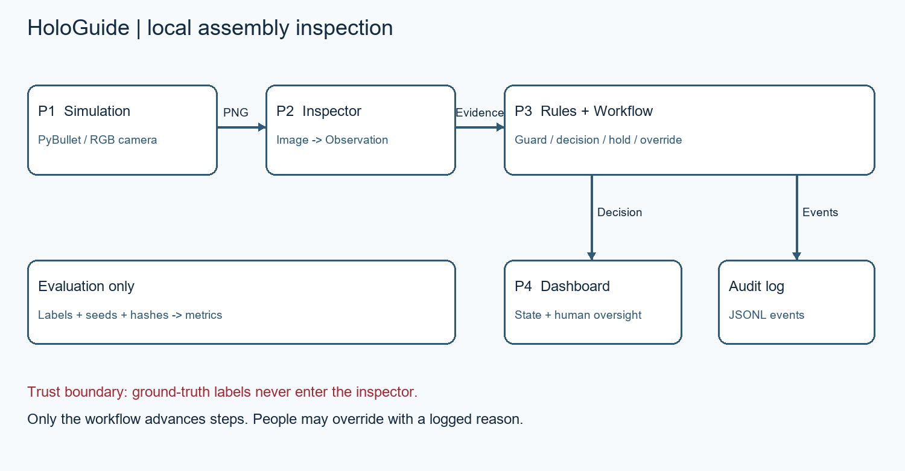

# HoloGuide: Person 4 writeup and final integration audit

Updated November 8, 2026. Scope: DSH-12, EVL-01b, DSH-10, EVL-05, DSH-07,
GIT-01. Earlier P4 implementation was merged as PR #2 (3e71d1f). This continuation
starts from integrated main 2a797f5 on fix/person4-final-integration. No dev branch
exists. No AGENTS.md was found. Feature freeze is respected: this closes explicitly
requested gaps without changing shared schemas, inspector/control internals, or
P1's simulation/scenario APIs. Existing work was preserved; no teammate branch
was merged, cherry-picked or force-pushed.

## Problem, architecture and responsibilities

HoloGuide checks a four-step virtual assembly for missing, wrong and premature
parts. Flexible image perception returns evidence; deterministic rules and
Workflow own all progression. Operators can review returned confidence/rationale
and submit a typed, identified override, recorded before advancement. It is a
synthetic simulation prototype, not a certified industrial safety system.



The actual integrated path is AssemblyEnv.render_to_file → inspector.inspect(path,
StepSpec) → validated Observation → RuleContext/rules → Workflow → Decision/audit
→ dashboard. P4 never changes workflow state/step directly and never passes
parts_present or label rows to an inspector. Real mode uses P1's existing backend
factory and P2's cv/gemma/hybrid factories. P2 accepts StepSpec directly; no adapter
flag is needed for those factories.

Teammate contributions now exist: [P1 technical section](PARTNER1_TECHNICAL.md),
[P2 AI writeup](WRITEUP_AI_INSPECTION.md), [P2 decisions](decisions.md), and
[P3 control handoff](../CONTROL_MODULE_PROGRESS.md). P1/P3 remain responsible for
their final video/recovery/safety contributions; this document does not assert
that their historical unchecked items or unprovided artifacts are complete.

## Six-task status and concrete evidence

| Task | Status | Evidence and precise remaining acceptance |
|---|---|---|
| DSH-12 | Partial | Real factory/render/inspector/workflow/audit path traced in current source; actual inspectors verified on an archived camera frame; adapter and UI tests pass. Full live camera-through-dashboard run requires installed PyBullet; Gemma path requires reachable provisioned Ollama. Run commands below on demo laptop. |
| EVL-01b | Complete tooling / available-inspector verification | Generator CSV contract confirmed; real OpenCV and Hybrid process P2's archived 640x480 PyBullet PNG through runner/CSV/report. Labels never enter inspection. Hash/config guards and returned P2 timeout/failure accounting tested. Full datasets/all-model measurements belong to EVL-05. |
| DSH-10 | Partial | New real one-click controller runs existing ScenarioRunner one inspection tick at a time, preserves frames/decisions/audits, supports stop/reset and separately selectable mocks. Edge cases explicitly inject review/timeout after successful real inspection; natural failures stop instead of being masked. Controller/UI tests pass; live full-sequence acceptance is skipped pending PyBullet/demo laptop. |
| EVL-05 | Blocked final acceptance | P2 narrative results exist; referenced raw datasets/results/provenance/recovery artifacts do not exist here. Local PyBullet and Ollama are unavailable. Obtain the original evidence archive or rerun the final commands on the laptop, record model/config/environment, regenerate comparison tables and share the archive. |
| DSH-07 | Partial | Indicator reads actual nested P2 model/endpoint settings, including defaults, strips endpoint credentials, distinguishes loopback from remote, and makes no zero-traffic claim. Reproducible manual checklist supplied. Genuine Wi-Fi-off run and local Gemma invocation remain unobserved. |
| GIT-01 | Partial | 12 missing task/area/priority labels actually created under OmarWaled234. Existing template/ignore rules retained. API reports main protected=false, no rulesets, no CI workflows; account admin=false. Owner must apply settings below. No protection change is claimed. |

Other prior P4 foundations (pytest setup, shared fixtures, camera/status/details,
typed override, audit viewing, metrics and report regeneration) are retained.
DOC-03b final edit and DOC-06 second-laptop/submission acceptance still depend on
real evidence and team review. Nice visual polish remains deferred.

## Dashboard and real demo behavior

`session.py` retains the exact inspected PNG after advancement and distinguishes
the inspected step from the current workflow step. Scene changes invalidate the
current preview; returned messages/confidence/rationale are shown unchanged.
Revision tokens reject stale submissions. Overrides and HOLD recovery use the
existing control APIs. Reset closes supported resources; immediate tab-close
cleanup is limited by Streamlit session lifetime.

`RealDemoController` uses P1's correct, missing_gasket, wrong_cover and wrong_order
ScenarioRunner episodes. Physical fault injection, correction and reinspection
stay in that API. Camera and returned decision/audit/progress update every tick.
The final episode uses the configured real inspector, then deliberately caps a
successful observation for review or returns a labelled timeout marker for the
HOLD demonstration. These are presentation injections, never measured model
failures. An actual failure/uncertain observation prevents the injection and
stops the demo. The operator override uses demo-operator and a recorded
DEMONSTRATION ONLY reason. No outcome is fabricated to continue an episode.

Stop prevents another synchronous tick; an in-flight inspector call remains
bounded by P2's timeout. Reset closes the demo and creates a fresh session.
The separate mock button remains labelled. P1's runner uses multiple scenario
episodes, not an uninterrupted single assembly; presenters must narrate resets.
The exact missing-gasket correction wording is control-owned; P2's decisions
document its current order-before-missing priority. P4 displays that actual message.
Three-minute timing and the real presentation rehearsal remain laptop acceptance.

## Evaluation method and final-evidence audit

The established src/evaluation package is retained. The generator's required CSV
fields are image_path, step_id, mistake_type, expected_status; optional seed,
parts_present and sha256 remain scoring/provenance inputs only. Image hashes and
dataset.json config are checked before inspection. Only image path/StepSpec reach
P2. Returned TIMEOUT and INSPECTION FAILED markers now populate CSV errors and
timeouts; invoked wrapper counters handle Hybrid diagnostics without counting a
skipped branch's stale failure. HOLD alone is not proof of timeout. Failed cases
remain in denominators and reports.

Accuracy = exact expected/actual status agreement by mistake type. False-block =
explicit BLOCK / expected PASS (N/A with no correct cases); HOLD/review are separate.
Latency = inspect + validation + rules, excluding rendering/artifact writes;
p95 uses linear interpolation. Dashboard latency includes workflow/audit and is
labelled separately; real scenario tick timing also includes rendering.

Provenance retains dataset/image hashes, config, effective inspector/model/endpoint,
code revision/dirty state and package/platform details. Reporting reads saved CSVs,
uses N/A for absent model measurements and optional supplied P1/P3 evidence only.

[P2's November 7 decision record](decisions.md) reports 200-image v1/v2 datasets
(80 correct, 40 per fault), RTX 3060 Laptop 6GB, gemma3:4b 4-bit, and code f110a1d
plus its working-tree predecessor. Reported v2 results: OpenCV/Hybrid 100% per
mistake and 0% false blocks; Gemma prompt v2 100% missing/wrong, 85% order and 7.5%
false blocks. Those are **P2-reported**, not independently remeasured here.
Hybrid made no Gemma calls on those clean datasets, so its speed is effectively
OpenCV speed. Full CSVs, manifests/image hashes, clean code/config provenance,
hardware/model digest, and outputs/recovery/cv-run1 were not supplied here.
No raw P3 final safety artifact exists here. These omissions prevent final-evidence
acceptance; historical/mock recovery is not substituted.

## Commands for outstanding live verification and final run

Use a provisioned demo-laptop environment (no model downloads during offline run):

```powershell
$env:HOLOGUIDE_BACKEND_FACTORY = 'src.simulation.backend:create_session'
$env:HOLOGUIDE_INSPECTOR_FACTORY = 'src.vision.factories:hybrid'
$env:HOLOGUIDE_MODEL_NAME = 'gemma3:4b'
$env:HOLOGUIDE_MODEL_ENDPOINT = 'http://localhost:11434'
.venv/Scripts/python -m pytest -q
.venv/Scripts/python -m streamlit run src/dashboard/app.py
# Select Real, Start selected mode, Inspect, then Run scripted real demo.
# Dedicated live acceptance test:
.venv/Scripts/python -m pytest -q tests/test_person4_continuation.py::test_live_real_demo_with_cv_when_simulator_is_installed
# Generate only if the agreed originals are unavailable; never overwrite them.
.venv/Scripts/python -m src.simulation.dataset --output outputs/dataset-final-v2 --randomize --seed 2026
.venv/Scripts/python -m src.evaluation.runner outputs/dataset-final-v2/labels.csv --inspector-factory src.vision.factories:cv --output outputs/evaluation/cv-final.csv
.venv/Scripts/python -m src.evaluation.runner outputs/dataset-final-v2/labels.csv --inspector-factory src.vision.factories:gemma --model gemma3:4b --endpoint http://localhost:11434 --output outputs/evaluation/gemma-final.csv
.venv/Scripts/python -m src.evaluation.runner outputs/dataset-final-v2/labels.csv --inspector-factory src.vision.factories:hybrid --model gemma3:4b --endpoint http://localhost:11434 --output outputs/evaluation/eval_final.csv
.venv/Scripts/python -m src.evaluation.report --result "OpenCV only=outputs/evaluation/cv-final.csv" --result "Gemma only=outputs/evaluation/gemma-final.csv" --result "Hybrid=outputs/evaluation/eval_final.csv" --output outputs/evaluation/final-comparison.md
```

Record warm-up policy, actual model digest/options, CPU/GPU, Ollama version and
Git dirty state. Retain every error/review/HOLD and failed scenario. Attach P1
recovery and P3 safety artifacts only when supplied with clear origin. Bundle
datasets, CSVs, provenance, tables and audits outside Git; share the archive in
the team's agreed storage and put its actual accessible link in the final writeup.
No accessible shared artifact URL is invented here.

## Verification performed on this P4 host

- Full pytest failed collection in six modules importing missing PyBullet.
- Explicit non-simulator subset: 160 passed, 1 live PyBullet acceptance test skipped.
- Real OpenCV and Hybrid evaluated the notebook's archived missing-gasket PNG;
  both returned BLOCK, with zero errors/timeouts/HOLDs/reviews; Hybrid Gemma calls=0.
  This is n=1 and has no correct-case denominator: false-block=N/A. It is not final
  dataset accuracy or demo-laptop performance. The reproducible command is
  `python scripts/person4_verify_sample.py --output outputs/new-sample-run`.
- Runtime dependency install: OpenCV/Ollama packages installed; official PyBullet
  binary-only install failed on Windows Python 3.12 and isolated portable 3.11.
  Prior source build required absent Microsoft C++ Build Tools. No forked simulator
  or system compiler was installed as a substitute.
- Local Ollama /api/tags timed out with a 2s deadline, including outside sandbox.
- No network interface was disabled. No offline rehearsal is claimed.
- Hygiene inspection/label mutation is preserved in ignored outputs/person4-hygiene-20261108.json.

## Owner-only branch protection action

Verified GitHub state: main protected=false; rulesets=[]; workflows=[]; dev absent;
OmarWaled234 admin=false. No reliable status check exists to require.
In repository Settings → Branches add a main protection rule: require PRs,
at least one approving review (P3 reviews P4 work), apply to administrators/no
bypasses, prohibit force pushes and deletion. Preserve any stronger settings
introduced since this audit. Do not add a required status context until actual
reliable PR CI exists. Equivalent owner API body for an unprotected main:

```json
{"required_status_checks":null,"enforce_admins":true,"required_pull_request_reviews":{"required_approving_review_count":1},"restrictions":null,"allow_force_pushes":false,"allow_deletions":false}
```

Endpoint: PUT /repos/OmarElkott/HoloGuide/branches/main/protection.
Labels actually added: DSH-12, DSH-07, DSH-10, EVL-01b, EVL-05, GIT-01,
area:dashboard, area:evaluation, area:repository, priority:must/should/nice.
No existing label was deleted or renamed, and no protection/bypass was changed.

## Remaining people-dependent actions, in order

1. P3 reviews the focused continuation; owner applies main protection.
2. Demo-laptop operator runs live dashboard/demo acceptance and full tests with
   PyBullet, provisioned Ollama and the agreed Hybrid setup.
3. P2 shares original raw evaluation/provenance archive or operator reruns commands
   above. P1/P3 supply their actual recovery/safety artifacts; P4 then completes
   final tables and writeup evidence review.
4. Operator performs [genuine offline checklist](PERSON4_OFFLINE_CHECKLIST.md),
   records actual local Gemma use and shares the evidence archive. Team completes
   final writeup/submission checks; P1's video remains P1-owned.

## Verified delivery and preserved local evidence

Draft [PR #4](https://github.com/OmarElkott/HoloGuide/pull/4) is verified open,
base main, head fix/person4-final-integration; it is not merged. The connector's
PR POST returned 403 Resource not accessible by integration. The existing Git
credential under confirmed OmarWaled234 successfully created the PR, then its
number/state/base/head were independently read through the GitHub connector.

Clean-code smoke evidence at f3d82de277534efc6bb383a8e7260b736c87286e is preserved in
outputs/person4-verified-sample-20261108. Both inspectors blocked the single
archived missing-part image, with 0 errors/timeouts/HOLDs/reviews. OpenCV latency
was 0.0390477 s, Hybrid 0.0260070 s (each n=1, therefore median=p95). These are
local smoke timings, not final target-laptop performance. False-block rate is N/A
because no correct cases were supplied; Gemma measurements are N/A and Hybrid's
Gemma call count was 0. The original notebook SHA256 is recorded alongside the
image, manifest, per-case CSV, tables and full provenance; working_tree_dirty=false.

outputs/person4-evidence-20261108.zip packages this smoke evidence, GitHub hygiene
snapshot and the offline checklist. This ignored archive is local, available to
the user for sharing; it is not falsely linked as a remotely hosted team artifact.
P2's missing final-evaluation archive is not reconstructed from summary numbers.
