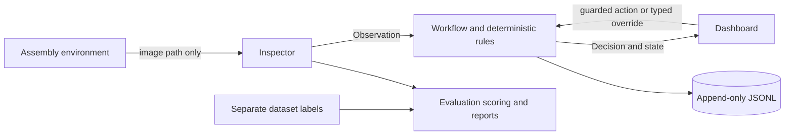

# HoloGuide project writeup draft and Person 4 handoff

Status: draft, November 1, 2026. Real evaluation and teammate contributions remain
pending. Simulation results are not evidence of physical-world performance.

## Problem and approach

Assembly errors require both flexible perception and predictable decisions.
HoloGuide explores a local assembly assistant for four configured steps: base
plate, gasket, cover, and bolts. The prototype should detect missing parts, wrong
parts, and incorrect order, explain the correction, and let an identified operator
submit an auditable override. It is a simulation-only hackathon prototype, not a
certified safety system.

The architecture separates evidence from authority: the simulator renders an image,
an inspector returns a validated Observation, deterministic rules create a Decision,
and Workflow alone changes progression. The dashboard never changes workflow state
or step directly. Config supplies cumulative expected parts and thresholds.
Existing control code and tests provide the authority boundary; the dashboard
adapts that interface without changing shared schemas.

This diagram is source text, not P1's required exported architecture image.

## Dashboard implementation

`src/dashboard/session.py` owns UI session resources and calls production control
interfaces: check_action, request_inspection, operator_override, clear_hold, and
invalidate_part. Environment mutation follows the action guard. Removing verified
parts rolls approval back through Workflow before changing the environment.
Override authorization and audit persistence remain control responsibilities.

`app.py` presents every WorkflowState with a status banner and uses returned
correction messages. The verified-step progress bar is separate from the last
decision's step ID. Returned source, confidence, rationale and Observation remain
visible. Camera bytes are validated before display; missing, corrupt and JSON
mock frames produce placeholders, not a fabricated camera feed. The displayed
inspection frame is retained after step advancement, while later scene changes
invalidate the current preview. Previously inspected frames remain separately
available. Inspector/model/endpoint labels describe configured values; no global
offline claim is made. Streamlit telemetry is disabled in project configuration.

The synchronous request has an Inspecting spinner. Dashboard latency measures
Workflow.request_inspection through decision and audit completion, excluding
rendering and UI work. Revision tokens and versioned buttons reject stale repeat
inspection/override submissions. Audit validation/filtering preserves original
JSONL export, and malformed logs produce an explicit error.

Session state survives reruns. Reset closes supported simulation resources;
weakref cleanup also closes them when objects are collected/process exits.
Streamlit offers no reliable immediate browser-disconnect callback; use reset
before leaving real sessions. Immediate tab-close resource release is not proven.

## Demo orchestration and limits

One click starts existing `run_mock_scenario` episodes: correct, missing_gasket,
wrong_cover, wrong_order, then low-confidence review, an injected TimeoutError,
HOLD acknowledgement, reinspection, and a demonstration-only override with identity
and reason. A timed Streamlit fragment advances one episode at a time, records
progress, shows complete transcripts and preserves each episode's audit path.
Stop prevents the next episode; reset creates a clean session. These local mock
episodes are brief and cannot interrupt an operation already executing.

No real inspection failure is replaced by a mock. The deliberate exception is
labelled fault injection, not a measured slow-call timeout. Production inspector
timeouts remain P2's responsibility. The full roadmap's timed three-minute
presentation and physically missing gasket under the cover require P1's finished
scenario runner/panel and camera scene plus P2's inspector. Current reusable mock
episodes demonstrate the control behavior, not that integrated physical sequence.
Closing evaluation numbers are explicitly unavailable.

## Real integration dependency inspection

Remote `main` now contains HOLOGUIDE_ROADMAP.md (commit 17d8e25); it was merged
normally into this feature branch. The roadmap is available and is the task source.
No AGENTS.md was found in the workspace/checkout. No `dev` branch exists; main
remains the PR target. Creating an integration branch or changing protection is
a team decision, not part of these changes.

P1's unmerged `feat/sim-assembly-env` (f701414) implements reset, render_to_file,
parts_present, and close. Its placement/removal methods raise NotImplementedError.
It has no dataset generator or scenario library. That branch was inspected but
not merged/cherry-picked. No real P2 inspector, model comparison results, dataset
manifest, or recovery output exists in the fetched branches. P3's implemented
control APIs differ from roadmap P2's signature: control supplies a StepSpec,
whereas the roadmap Inspector accepts a step ID. Shared contracts were unchanged.

`backends.py` provides an explicit StepIdInspectorAdapter and a configured
module:function factory seam. A real factory must return DashboardSession with
real environment and inspector plus actual model/endpoint metadata. The UI fails
visibly if absent; no implicit constructors, signature guessing, or fallback.
Real rendering uses P1's render_to_file(path), with no access to parts_present.
This adapter is tested using doubles; real integration is not claimed complete.

## Evaluation method and reproducibility

The established `src/evaluation/` package is retained; no duplicate `src/eval/`.
No generator/manifest contract is available. The CSV adapter remains provisional:
image_path, step_id, mistake_type, expected_status. P1 must confirm those fields
or supply an adapter mapping before final evaluation. Labels stay outside inspector
calls; only path and configured step are passed. Each image is an independent
case, with cumulative RuleContext requirements. Sequential recovery belongs to P1.

Accuracy is exact expected/actual decision-status agreement per ground-truth
mistake type. False-block rate is explicit BLOCK / expected PASS cases, undefined
without eligible cases. HOLD and needs_review are separate counts. Failed cases
remain in the denominator and CSV. Timeout counts require explicit TimeoutError
evidence; low confidence/HOLD alone is not enough. Real inspector wrappers may
return ambiguous low-confidence fallbacks; P2 must provide agreed timeout evidence
if exact timeout attribution is needed. No shared marker schema was invented.

Evaluation latency measures inspect + validation + rules, excluding rendering and
artifact writes. Median and linearly interpolated p95 are computed from all cases,
including failures. Dashboard latency includes workflow/audit and must not be
combined with evaluation latency without labelling the different intervals.

Each new run saves CSV, JSON summary, Markdown tables and provenance containing
manifest/image SHA256, full assembly config, inspector/model/endpoint metadata,
Git revision/dirty state, Python/platform and relevant package versions. Record
the actual GPU/CPU, Ollama version/model digest and warm-up policy on the target
laptop; these are not inferred. The runner refuses to overwrite prior artifacts.

The standalone report command regenerates tables from saved CSVs without running
inspection. Missing Gemma/OpenCV/Hybrid columns are N/A. Different manifest hashes
trigger a comparison warning; compare identical dataset/configuration conditions.
Legacy results are labelled as lacking provenance. Optional recovery/safety JSON
attachments show supplied P1/P3 evidence without inventing an output schema.
Generated files and models remain ignored.

## Results and trade-offs

No real dataset or configured model is available. Therefore no model accuracy,
latency, recovery rates or network measurements are reported here. Tests are
software validation, not model evaluation. Complete the following with actual
report output after the final run:

| Measurement | Gemma only | OpenCV only | Hybrid |
|---|---|---|---|
| Accuracy: missing part | N/A | N/A | N/A |
| Accuracy: wrong part | N/A | N/A | N/A |
| Accuracy: wrong order | N/A | N/A | N/A |
| False-block rate | N/A | N/A | N/A |
| Median / p95 latency | N/A | N/A | N/A |
| Explicit timeouts | N/A | N/A | N/A |

Recovery trials: pending P1's 20 runs/scenario. Safety: P3's existing randomized
invariant tests are exercised by pytest; no new independent final safety artifact
or network/offline-hardware evidence is asserted. Offline rehearsal remains pending.

The local topology targets privacy and predictable connectivity but does not
establish zero network activity. Deterministic rules constrain uncertain evidence;
they cannot correct a confidently wrong observation. Mock development unblocks
UI/control testing but does not measure vision quality. Colour-based fallback and
Hybrid choices await P2's measured go/no-go evidence.

## Teammate sections

- P1 DOC-03c: **pending** simulation geometry, dataset generation/seeds, recovery
  trials and exported architecture image. The unmerged skeleton is not a final section.
- P2 DOC-03d: **pending** model choice/topology, prompts, timeout/retry/fallback,
  go/no-go measurements and real error analysis.
- P3 DOC-03e: final section **pending**. Existing CONTROL_MODULE_PROGRESS.md informs
  this draft: AI reports; control decides; order guard precedes placement; HOLD
  does not authorize progression; overrides require identity/reason and durable
  audit. Its unchecked historical claims are not treated as final measurements.

## Person 4 task audit (roadmap Section 5)

Statuses describe acceptance, not just file presence. 'Implemented' means the
owned behavior was exercised; dependencies are explicitly scoped below.

| Task | Before this continuation | Current status | Evidence / remaining acceptance |
|---|---|---|---|
| TST-01 | Implemented | Implemented | pytest.ini, tests/conftest.py, README; expanded behavior tests |
| EVL-01a | Implemented | Implemented | evaluation/metrics.py; denominator/latency tests |
| EVL-01b | Partial | Partial | runner.py supports existing/mock and factory inspectors; P1 manifest agreement and real P2 integration blocked |
| DSH-01 | Implemented | Implemented | Streamlit app/session; AppTest startup/rerun/reset |
| DSH-02 | Partial | Implemented foundation | Validated image panel, honest placeholders, verified progress; real camera blocked by P1 |
| DSH-03 | Partial | Implemented | All seven state banners and returned correction messages |
| DSH-04 | Implemented | Implemented | Decision source/confidence/rationale; last/current step distinction |
| DSH-12 | Blocked | Partial / blocked integration | Explicit env/inspector factory + step-ID adapter tested; P1/P2 implementations required |
| DSH-05 | Implemented | Implemented | Identity/reason + control override; stale-submission protection |
| DSH-07 | Partial | Partial / blocked evidence | Actual configured endpoint/model indicator; no zero-external-traffic claim; real offline rehearsal pending |
| DSH-06 | Implemented | Implemented | Audit filter/export; empty/malformed handling tested |
| DSH-09 | Missing | Implemented | Spinner, measured/defined latency; revision tokens |
| DSH-10 | Missing | Partial | Full mock episodes plus review/HOLD/override tested; timed integrated roadmap scene awaits P1 scenario support/P2 |
| DSH-11 | Missing | Missing / deferred Nice | Not pursued while required real integration remains blocked |
| EVL-02 | Partial | Implemented tooling | report.py reads saved CSV; comparison/N/A/provenance tests; real tables await dataset/results |
| EVL-05 | Blocked | Blocked | Dataset, real inspectors, frozen config/model and target laptop absent |
| GIT-01 | Partial | Partial | Ignore rules/PR template retained; review checklist; labels/protection need leader agreement |
| DOC-03a | Partial | Implemented draft | This problem/architecture/method/trade-off/results-placeholder draft |
| DOC-03b | Blocked | Blocked | Final teammate sections, real evidence and review required |
| DOC-06 | Partial | Partial | Fresh-install attempt recorded below; second laptop/offline rehearsal/submission pending |

DSH-08 belongs to P1 and is not rebuilt here. EVL-03 (P1 recovery) and EVL-04
(P3 safety invariant) are consumed as dependencies, not reimplemented.

## Verification and submission

Current implementation checkout: 109 tests passed, including existing control
tests and new image, real-adapter-double, session, UI, demo, report and provenance
tests. The earlier 98-test clean-clone run reused a venv and is historical only.
This continuation created `outputs/fresh-install-20261101` from committed Git
source and a new `.venv`, then attempted the full `pip install -r requirements.txt`.
Full installation failed building pybullet 3.2.7 on Windows/Python 3.12:
`Microsoft Visual C++ 14.0 or greater is required`. The documented mock-development
subset installed successfully in that new venv: 109 tests passed and pip check
reported no broken requirements. This is not a full simulator installation.
Use a supported wheel/team Python environment or install the required
C++ Build Tools before retrying the full requirements install.

Second-laptop testing, Wi-Fi-off hardware rehearsal, real model evaluation, video,
Kaggle notebook/writeup upload, logged-out links and submission confirmation are
**pending**, not implied by local tests. No tags, merges, admin settings, or
submission actions are performed automatically.

Next actions in order:

1. User opens the draft PR from the pushed branch: automatic creation returned
   HTTP 403 `Resource not accessible by integration`; see docs/PR_DRAFT.md for
   exact operation and manual link. P3 reviews authority boundaries; leader confirms main
   as current integration base and resolves roadmap/dev mismatch. Discuss issue
   labels and branch protection/review enforcement; no admin changes made here.
2. P1 finishes/merges environment placement/removal, scenarios/panel and labelled
   dataset; confirms the manifest contract and supplies recovery evidence.
3. P2 supplies configured inspectors, bounded timeouts, explicit interface choice,
   model/endpoint metadata and timeout evidence; wire the explicit backend factory.
4. On the demo laptop run the README real evaluation command per inspector, retain
   provenance and generate comparison tables; attach actual recovery/safety outputs.
5. Collect DOC-03c/d/e, fill real results, then P4 finalizes DOC-03b with team review.
6. Perform second-laptop fresh install and Wi-Fi-off rehearsal, complete roadmap
   submission checklist, videos/notebook/links and obtain final team approval.
